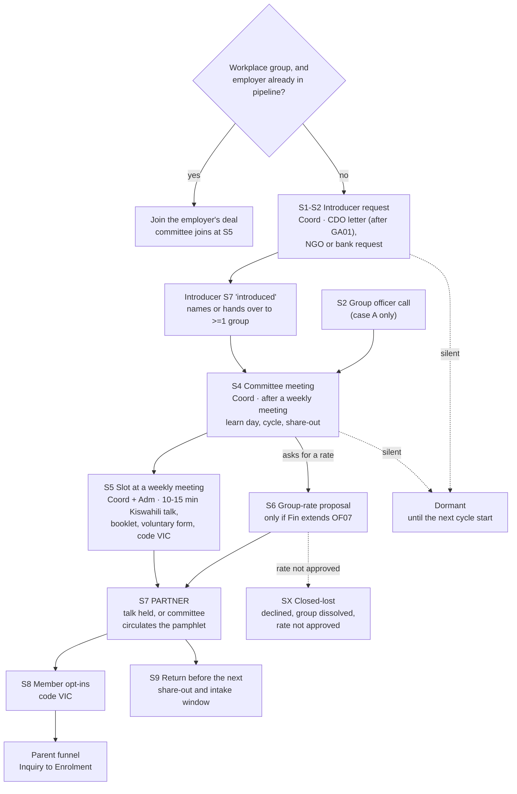

# VICOBA integration plan

Prepared: 13 October 2026. Phase 1 (plan only). Nothing in this plan is built; no database, draft, map or deck has changed.
Companion: `docs/plans/vicoba-sourcing-plan.md` (sources and yield; written by a separate worker). This plan assumes its records arrive as described in "Assumed input" below and does not depend on its numbers.

VICOBA (Village Community Banks, *vikoba*) are community savings-and-loan groups of roughly 15 to 30 members who meet weekly, save in shares, lend to each other and share out at the end of a cycle. They are close kin to VSLAs and to the community microfinance groups (CMGs) that councils register under the Microfinance Act 2018. The user wants them as a new subsegment under the employer/company segment, worked "the usual" way: inventory, enrichment, confidence bands, drafts and pipeline.

## Decisions taken (13 October 2026)

- **Where VICOBAs live: in the company list (master).** The user decided this: "No need to create a whole new cluster when we can just consider it a company." Groups go into the master as a subsegment of savings groups, as in decision 1 below. No separate run will be created. This settles the reconciliation question in the sourcing plan's section 0.
- **Definition and women's-group priority:** see section 0.
- **KINEFA is unknown to the user.** It appears only in Silverleaf's own discount schedule, as the row "KINEFA discount": "Applicable to KINEFA members only who send their primary aged students to Silverleaf", at 7/12/17% for 50/100/150 children. That row is the source of OF07. Nothing else in the repository says what KINEFA is. The earlier notes that savings groups are "reached through KINEFA" were an assumption and are withdrawn. KINEFA is not treated as an introducer until whoever drew up the schedule says what it is.

## 0. Definition of the subsegment (user and orchestrator, 13 October 2026)

The user asked the orchestrator to define VICOBAs. They noted that many are literally named VICOBA and that many are women-centred. Women's groups are a priority, on the hypothesis that women members care about quality education for their children.

**A group is in the VICOBA subsegment when all of these hold:**

1. **It is a community savings-and-loan group.**
   - Members buy shares at regular meetings (usually weekly).
   - The group lends to its members from the pooled fund.
   - It shares out the savings at the end of a fixed cycle (usually 9–12 months).
   - Most keep a small social (emergency) fund.
   - A constitution and an elected committee (chair, secretary, treasurer) run it.
2. **It is identified as one by a source.** At least one of:
   - its name says so: *VICOBA*, *VIKOBA*, *Village Community Bank*, *VSLA*, *Village Savings and Loan*, *kikundi cha kuweka na kukopa*;
   - a council register lists it as a Tier 4 community microfinance group;
   - an intermediary (an NGO, a bank's group product, a ward officer) introduces it as a savings-and-loan group.
3. **It meets in the catchment:** within 25 km of a campus, by its ward or meeting place.
4. **It is supplied as a group.** It reaches us as a group record from a council register, an intermediary or the group itself, never from a list of loan recipients or members.

**What it is not:**
- **SACCOS** are registered co-operatives with a TCDC licence. They stay in their own SACCOS subsegment.
- **Rotating groups** (*upatu*, *mchezo*) have no loans and no share-out, so they are out unless a source calls them a VICOBA.
- **Microfinance companies and banks** (Tier 2 and 3, VisionFund, Akiba) are intermediaries and introducers, not groups.

**Women's groups: tag them and work them first.**
- A group is tagged `women_group` only on source evidence, never by inference:
  - its name names women: *wanawake*, *akina mama*, *kina mama*, *women*, *mama*;
  - the source calls it a women's group;
  - it is a council 10% loan **women's group** supplied by the council as a group.
- Nobody's sex or status is inferred from a member's or leader's name. The repository holds no member data.
- Tagged groups come first in every wave: the introduction request, the meeting slot, the talk. The tag is a priority, not a different offer: the same family offer and the same drafts apply, with the talk aimed at mothers' questions (curriculum, safety, transport, instalments timed to the share-out).
- The hypothesis is tested, not assumed. The pipeline records `women_group` on every opt-in and enrolment (S8), so partner reports can compare conversion for women's groups with other groups once at least 3 groups exist on each side. As usual, a count below 3 shows as "fewer than 3".

**Subtypes** (they replace §2's six `VICOBA — …` labels where they differ):
- `VICOBA — women's group`
- `VICOBA — mixed or unspecified`
- `VICOBA — youth group`
- `VICOBA — group of people with disabilities`, recorded only when the council or intermediary supplies it as such. Membership of such a group is not recorded about any person.
- `VSLA — NGO-programme group`

---

## 1. Evidence

Everything below was read from the repository at `4670b3d` and from read-only copies of the master and government-run databases (copied 13 October 2026; never written back).

### 1.1 How savings groups live in the master today

| Fact | Value | Where |
|---|---|---|
| Organisation IDs | `O` + 12 hex characters (`O58a6835ae86b`), generated by `hid("O", ...)` in the adders. **No organisation ID uses a `SAC-` prefix.** `SAC-` is the *partner code* for opt-ins in `docs/strategy/partnership-pipelines.md` §3 | `organisations.organisation_id`; `scripts/master/add_introducers.py` `hid()` |
| Organisation segment | `Savings group` (117 records) | `organisations.segment` |
| Subtypes | `SACCOS — community/open-bond (TCDC licence class A)` 61, `... employer/institution-based (class A)` 38, `... employer/institution-based (class B)` 10, `... community/open-bond (class B)` 6, `SACCOS (OSM-mapped)` 2 | `organisations.subtype` |
| Source | TCDC licensed-SACCOS list to 30 June 2022 (ushirika.go.tz PDF); postal box only | `organisations.source_url`, `address` |
| Routes | 0 emails, 1 phone, 0 websites | `organisations` |
| Location | precision city 57, locality 32, town 26, point 2. 57 are "Arusha (city centre, unspecified)" and default to Ilboru | `geocode_precision`, `locality`, `campus` |
| Outreach segment | `SACCOS members` (119 plans for 117 organisations; 2 alternative contact plans) | `outreach_plans.segment` |
| Track and status | AQ00 118, AQ02 1; `Needs research` 118 | `acquisition_track_id`, `review_status` |
| Flow, campaign | F03 (design only, disabled), C02 | `outreach_plans.flow_id`, `campaigns` |
| Value modules | `VM01; VM02; VM03; VM06; VM19` | `value_module_ids` |
| Offer IDs | `OF01; OF02; OF09; OF07` | `offer_ids` |
| Strategy | `Safd376f9d269`, title "Savings-group partnerships", segment **"SACCOS / VICOBA"**: "Ask district cooperative and community-development offices for current local groups. Arrange a committee/member session and assess payment dates against the savings cycle. Confirm all proposed financial terms." | `strategies` |
| Kiswahili | `saccos_copy()` writes an English request, an English offer, and a Kiswahili *first message* stored in `offer_message_sw`; every plan carries `NATIVE_REVIEW` ("Kiswahili draft: native-speaker review required before release.") | `scripts/messaging/draft_master_messages.py` L277-300, L839-849; `offer_lib.NATIVE_REVIEW` |
| Confidence | Every SACCOS row with an email would be **low**: "savings group: Kiswahili review and Finance's approval of the member rate first". 116 have no email, so they sit on the call sheet band | `scripts/messaging/export_resend_contacts.py` `company_rows()` L303-304 |
| Lead map | Shown under Employers with subsegment "Savings groups (SACCOS)"; the page fails if a contact name, email or phone reaches it | `scripts/maps/build_lead_map.py` L314-315, `privacy_check()` |
| Contact research | Planner skips segment `Savings group` ("reached through KINEFA, not one by one") | `scripts/contacts/plan_contact_research.py` L14, L60 |
| Reach tiers, recipient resolution | SACCOS excluded from `employer_reach`; never clustered with employers | `rank_employer_reach.py` L85; `resolve_master_recipients.py` L6 |

No master record names a VICOBA (`name`/`subtype` search: 0).

### 1.2 Where the introducer routes already are

The government run (`arusha-government-2026-09`) holds the offices a VICOBA introduction would go through:

| Post | Records | Holder named |
|---|---|---|
| Ward Community Development Officer (*Afisa Maendeleo ya Jamii wa Kata*) | 129 | 0 |
| Head of Community Development Division (council) | 9 | 3 |
| Community Development Unit, Regional Secretariat | 3 | 1 |

No ward office has a published phone or email. Wards are held (GA00) until their council's introduction (GA01) is recorded; 4 pilot councils are on GA01 (Arusha City, Arusha District, Hai, Meru). The government plan forbids taking "resident registers, voter lists, beneficiary lists or pupil lists, even when offered" and records an offered list as `lists_offered` (`plans/b2b-government-leads-plan.md` §3; pipelines §1).

NGO and bank introducers are already master organisations in some cases: NGOs as `office:ngo` employers (64), banks as `amenity:bank` (26). Council news captured by the government collector already mentions VICOBA programmes (for example Longido: "PWC YAANZISHA VIKUNDI 25 VYA VIKOBA LONGIDO", `data/raw/government-research/council_sites/longidodc.go.tz_2026-10-10.json`), which is the kind of aggregate the sourcing plan will meet.

### 1.3 Rules that bind this design

- **Offer terms** come only from `data/reference/silverleaf-offer-register.json` (v `2026-10-12-offer-v5`). OF07 (member association rate: 7% at 50 students, 12% at 100, 17% at 150) is documented for KINEFA only; Finance must agree to extend it to any other savings group. The family offer OF01, OF02, OF09 is usable now. First messages state no terms; every offer-stating draft carries `OFFER_TERMS_NOTE`.
- **First-touch rule** (pipelines §4): case A direct, case B Attn through a general inbox, case C redirect request. The SACCOS row says "Kiswahili wording, to be drafted and reviewed by a native speaker".
- **Fallout** (pipelines §5): "SACCOS: a call to the chair or secretary, then a hand-delivered Kiswahili letter. The ward community development officer is a warm route. Dormant until the society's next members' meeting or AGM."
- **E6** (pipelines §7): win at S7 is "the committee circulates to members, or a meeting slot is held; a group rate is a stronger optional form"; lost reason `rate_not_approved`; decision 16 combines an employer-based savings group with its employer.
- **Opt-in** (pipelines §3): members opt in themselves; no partner hands over a list; parent data never enters the repository; totals per partner code only; counts of 1 or 2 shown as "fewer than 3".
- **Contact research**: only what a source publishes for contact purposes; every lead kept and labelled incomplete rather than dropped; robots and blocks honoured; every search and lookup logged in the research ledger.
- **Partner-lead method §5**: "There is no public register of VICOBA groups ... known to ward and district Community Development Officers"; routes are council community development offices, NGO intermediaries (SEDIT, CARE, Aga Khan Foundation), faith and market associations, and NMB/CRDB branch managers "who ... know the groups even though they cannot share customer data".

### 1.4 Assumed input

Records arrive mostly as: group name; ward or village; council; sometimes a meeting place and an approximate location; sometimes a sponsoring NGO, bank branch or church; rarely a published group contact; usually only office routes (ward or council CDO, NGO field office, bank branch). Some sources give only aggregates ("25 groups formed in Longido"), which are not group records.

---

## 2. Design at a glance

```text
data/raw/vicoba/  (raw captures, coverage logs)          government run (CDO posts, ward points)
        |                                                         |
        v                                                         |
scripts/collection/build_vicoba_intake.py  ---- ward points ------+
        |   writes: master_intake_<date>.csv (shared contract) + groups_<date>.jsonl (VICOBA fields)
        v
validate_intake.py  ->  preflight_update.py  ->  scripts/master/add_vicoba_groups.py --apply (one transaction)
        |
        v
master: organisations (segment "Savings group", subtype "VICOBA — ..."), facts, review items, source records
        |
        +--> scripts/master/link_vicoba_introducers.py   (group -> NGO / bank / CDO introducer; reviewed file)
        +--> scripts/messaging/draft_master_messages.py   (Kiswahili group request, introducer request, offer)
        +--> scripts/messaging/draft_run_messages.py      (government run: ward CDO introduction letter, held until GA01)
        +--> export_resend_contacts.py vicoba_rows()     (bands; delivery list for every group; email rows for introducers)
        +--> build_lead_map.py                           (VICOBA layer, aggregated by ward)
        +--> export_master_workbook_data.py / build_master_workbook.py, call sheet, deck
```

The group is the lead; the introducer is usually the first recipient. One introducer request covers every group that introducer knows, so an NGO field office or a CDO receives one request per wave, never one per group.

---

## 3. Decisions

Each decision has options and a recommendation. The user approves or changes them before phase 2.

### Decision 1. Where VICOBAs live

| Option | For | Against |
|---|---|---|
| **A. Master, as a new subsegment of E6** (segment `Savings group`, subtype `VICOBA — ...`, outreach segment `VICOBA members`), with raw captures staged in `data/raw/vicoba/` and a deterministic builder producing a master intake, as the gap census does | The user placed them under the employer segment. E6, its funnel, the SACCOS dedupe, the strategy record ("SACCOS / VICOBA"), the drafting, exporter, map and workbook paths all live in the master. The contact planner already skips savings groups. One database gives one-contact-per-organisation across employers, banks, NGOs and groups | Records are low-evidence and short-lived (groups dissolve or re-form at share-out); precision is ward-level; more personal-data risk than employers; the master workbook is committed |
| B. A separate run (`data/runs/arusha-vicoba-<date>/`, rebuilt by its own pipeline), as welfare and government do | Rebuildable from committed inputs; keeps churn and personal-data risk out of the master and its committed workbook | Duplicates the drafting, exporter, map and workbook paths a third time; SACCOS dedupe and the employer-combined deal (decision 16) cross a database boundary; contradicts the user's placement |

**Recommendation: A**, with raw staging and these guards: a `last_confirmed` fact and a 12-month staleness hold (section 5); `ward` location precision that never produces a distance claim; the privacy rules in decision 3; and introducer routes referenced, not copied, from the government run.

**What would change it to B:** the sourcing plan finding that most records arrive as CDO-held registers carrying members' or officers' personal details, or a yield large enough (well over 1,000 short-lived groups) that the master workbook becomes mostly VICOBA. Either would argue for a rebuildable run outside the master.

**ID prefix.** The brief proposed `VIC-` ids. The master's IDs are `O` + hash and nothing in the master uses `SAC-` as an id, so a prefix would break the master's ID convention and every adder's matching. **Recommendation:** keep `O` ids, generated as `hid("O", "vicoba", group_key)`; carry the natural key as the fact `vicoba_group_key`; use `VIC-` as the **partner code** prefix for member opt-ins (beside `SAC-`), so S8 totals separate VICOBA from SACCOS.

### Decision 2. Record shape, dedupe, intake and incomplete labels

#### 2a. Fields

Columns the master already has carry what they can; the rest are facts, each linked to its source record (so every claim stays traceable).

| Field | Where | Rule |
|---|---|---|
| Group name | `organisations.name` | As the source writes it (Kiswahili kept). A name that embeds a person ("Mama Neema Group") is kept as published, but withheld on the map (decision 7) |
| Segment | `organisations.segment` = `Savings group` | Shared with SACCOS, so existing skip-lists and family rules cover VICOBA |
| Subtype | `organisations.subtype` | `VICOBA — community`, `VICOBA — NGO-sponsored`, `VICOBA — bank-linked`, `VICOBA — faith-based`, `VICOBA — workplace`, `VICOBA — unclassified` (same dash style as the SACCOS subtypes) |
| Ward, council, village or mtaa | facts `ward`, `council`, `village_or_mtaa`; `organisations.locality` = "`<village>, <ward> ward, <council>`" | Ward and council names spelled as the government run's `admin_units` spell them (reviewed mapping for variants) |
| Campus, distance band | `campus`, `distance_km`, `transport_band`, `radius_tier` | From the ward reference point in the government run (`admin_units` lat/lon), or a public venue's point when one is published |
| Location precision | `geocode_precision` = `ward` (new value), or `point` for a published public venue | `ward` is an estimate: drafts never state a distance from it |
| Meeting place | fact `meeting_place_public` | **Public venues only** (church hall, school, ward office, market, bank branch). A private home is never recorded: it is a home address |
| Meeting cadence | fact `meeting_cadence` ("weekly, Thursday afternoon") | As published or as the committee states it at S4 |
| Cycle and share-out | facts `cycle_start_month`, `share_out_month` | Only as the committee states them; never inferred |
| Member count | `size_evidence` ("about 25 members, as published by <source>"), `headcount` | Only when published or stated by the committee |
| Registration | facts `registration_number`, `registration_authority` (council CMG register, LGA) | Only when published |
| Sponsor or intermediary | facts `sponsor_name`, `sponsor_kind` (ngo, bank, church, mosque, council, employer, other), `sponsor_ref` | `sponsor_ref` is a master `organisation_id`, or `welfare:<run-id>:<organisation_id>`, or blank with a review item |
| Introducer route | facts `introducer_kind` (cdo_ward, cdo_council, ngo_field_office, bank_branch, faith_office, group_published), `introducer_ref` | `gov:arusha-government-2026-09:<ward office organisation_id>` for a CDO; a master `organisation_id` for an NGO or bank |
| Natural key | fact `vicoba_group_key` | `VIC|<council>|<ward>|<normalised name>` |
| Status | facts `record_status`, `last_confirmed`, `sources_seen` | See 2d |

Contacts (group officers) go in `contacts` only under decision 3's rules: name and role (*Mwenyekiti*, *Katibu*, *Mweka Hazina*) as published, and a phone only with a recorded basis.

#### 2b. Dedupe rules

1. **Normalise the name**: case, punctuation, and the words "VICOBA", "VIKOBA", "Kikundi cha", "Kikundi", "Group", "Women Group", "Wanawake", "Vijana" removed for the key only (the record keeps the published name).
2. **Same group across sources**: an exact `vicoba_group_key` match, or an exact `registration_number` within one registration authority, is the same group. Its sources accumulate (`sources_seen`, one `entity_sources` link each); conflicting values (meeting day, sponsor) become `Multiple source values` review items, never overwrites.
3. **Similar names are never merged**: same normalised name in the same council but a different or missing ward goes to review (`VICOBA possible duplicate`). Common names (Upendo, Tumaini, Umoja, Mshikamano, Juhudi, Faraja, Neema, Amani and others, kept in `data/reference/vicoba-common-names.json`) never produce a fuzzy candidate across wards; they match only on the full key.
4. **Against SACCOS**: a VICOBA is never merged with a SACCOS. A normalised name equal to a SACCOS name in the same council raises `VICOBA may be a registered SACCOS` (groups graduate into SACCOS); a reviewer decides.
5. **Against employers**: a workplace group whose name carries an employer's name gets the fact `employer_ref` and joins that employer's deal (decision 16 of the pipelines document applies unchanged).
6. **Aggregates are not records**: "25 groups formed in Longido" becomes a fact on the sponsor or ward (`vicoba_groups_reported`), never 25 organisations.
7. **Gap census**: `scripts/collection/build_gap_census.py` currently drops OpenStreetMap features named VICOBA with the reason "the master's savings-group list covers them", which is no longer true. They become VICOBA candidates for the builder instead.

#### 2c. Intake path

The shared intake contract is kept, and the VICOBA-only fields travel beside it, as the gap census does:

1. `scripts/collection/build_vicoba_intake.py --date <date>` writes `data/raw/vicoba/master_intake_<date>.csv` (shared contract: `segment`, `subtype`, `locality`, `geocode_precision`, `latitude`, `longitude`, provenance columns) and `data/raw/vicoba/groups_<date>.jsonl` (one line per group: every field in 2a, each with source URL or path, locator, acquired and verified dates, excerpt).
2. `python skills/silverleaf-create-lead-list/scripts/validate_intake.py data/raw/vicoba/master_intake_<date>.csv`.
3. `python skills/silverleaf-update-lead-list/scripts/preflight_update.py "outputs/master/Silverleaf Master Database.sqlite" data/raw/vicoba/master_intake_<date>.csv`. Its identity key is name plus locality; because `locality` carries village, ward and council, an exact match is the same group, and anything else is an insert or a review item.
4. `python scripts/master/add_vicoba_groups.py --date <date>` previews; `--apply` writes in one transaction: source files and records, organisations, facts, `entity_sources`, review items, outreach plans in status `Needs research` (the drafter fills them), and the two new `outreach_plans` columns (decision 6). It matches by `vicoba_group_key`, then registration number, before inserting.
5. `link_vicoba_introducers.py`, `draft_master_messages.py`, `refresh_acquisition_metadata.py`, `export_master_workbook_data.py`, `npm run build:workbook`, `verify_master.py`, as the update order requires.

The data contract (`lead-list-data-contract.md`) records the new controlled labels: the six subtypes, outreach segments `VICOBA members` and `VICOBA introducers`, and precision `ward`.

#### 2d. Incomplete groups are kept and labelled

Every group with a name and at least a council (or a source that names its area) is kept. Nothing is dropped except junk (an aggregate, a non-group such as a bank product name) and records outside Tanzania. Groups beyond 25 km are kept with radius tier `>25 km` and held, as SACCOS are.

| `record_status` | Meaning | Effect |
|---|---|---|
| `complete` | Name, ward, council, an introducer route, confirmed within 12 months | Can reach S1 |
| `incomplete: no ward` | Council only | Held; review item asks for the ward |
| `incomplete: no introducer route` | Located, but no CDO, NGO, bank or published group route | Held |
| `incomplete: name only` | Name and area text only | Held |
| `stale: not confirmed in 12 months` | `last_confirmed` older than 12 months (a group can dissolve at share-out) | Held until a source or the committee confirms it |

Each label also writes a review item (`VICOBA record incomplete` or `VICOBA stale`) naming what is missing. Drafts are written for held groups but stay `Needs research`.

### Decision 3. Contact routes, confidence bands and privacy

#### 3a. Routes, in order of use

1. **The introducer** (warm, usual): the ward CDO through the government run's protocol (council introduction first), the NGO field office that sponsors the group, the bank branch where it banks, or a faith office that hosts it.
2. **A route the group or a public body publishes for the role**: an officer's role phone on a council page or an NGO report, or the group's own page.
3. **The meeting place, at meeting time**, only after an introduction or the committee's agreement. Never an unannounced visit: a VICOBA meeting is a private meeting where cash changes hands.

#### 3b. Bands

The exporter's bands today are email-based. VICOBA rows rarely have email, so their band is computed from the route to the group, and the channel (letter, call, email) is a separate property.

| Band | VICOBA definition | Case | First touch | If silent |
|---|---|---|---|---|
| **High, direct** | A group officer (chair, secretary or treasurer) named for the role by the group or a public body, with a role route published for them, confirmed within 12 months; or an officer who agreed by phone to be contacted (consent recorded) | A | Kiswahili call to the officer asking for a short committee meeting; the Kiswahili letter follows "as discussed" | Named-person fallout: one follow-up, a close, then dormant until the next cycle |
| **High, indirect** | A named officer known from a source, reachable only through an introducer; or an introducer who has agreed to introduce the group (introducer at S7 `introduced`) | B | The Kiswahili letter addressed to the committee ("Kwa: Mwenyekiti wa ..."), handed over by the introducer | Ask the introducer once; dormant until the next cycle |
| **Medium** | Group identified (name, ward), an introducer route published (CDO office after GA01, NGO field office, bank branch), no named officer | C | The introducer request (redirect equivalent): one request per introducer per wave, naming the groups it covers | Introducer fallout: a call after 2 working days, then a letter by hand, then dormant |
| **Low (held, S0)** | Any `record_status` other than `complete`; or the CDO's council has no GA01 introduction yet; or the sponsor link is unverified; or the Kiswahili template is not yet reviewed (a one-time gate per template version) | none | Not contacted | Promoted when the gap closes |
| **Call sheet** | Not a band for VICOBA: a channel. Groups and introducers whose route is a phone appear on the VICOBA call sheet in their band | as band | as band | as band |

Two departures from the SACCOS rule, both recommended:
- **The Finance condition does not hold the first touch.** SACCOS rows are low because OF07 is in their `offer_ids`, although the first message states no terms. VICOBA drafts carry OF01, OF02 and OF09 only (decision 5), so Finance gates nothing until a group rate is proposed at S6.
- **The Kiswahili review is per template version, not per lead.** Once a native speaker approves a template version (recorded in `data/reference/kiswahili-reviews.json`: template ID, version hash, reviewer role, date), drafts built from it drop `NATIVE_REVIEW`. Until then every VICOBA draft is held low.

#### 3c. Personal phones and privacy

**Rule.** A group leader's personal mobile is private. It is recorded only when a public body or the group itself publishes it for the role (contact-research's existing rule: "a mobile the organisation publishes" is `pdpa_risk medium`), and then only in `contacts.role_phone` with the fact `phone_basis = published_for_role` and its source. It never goes into `organisations.phone`. A number a CDO, NGO or bank passes on, but does not publish, is not a source: the introducer asks the officer to call Silverleaf, or Silverleaf records the officer's own agreement on a call. A consented number is kept in the partnerships call log outside the repository; the master records only the fact `phone_basis = consent_recorded <date>`, with no number.

Also never recorded: member names, member counts by person, members' phones, a meeting place that is a home, anything about members' children, loans or savings balances. An offered member list is refused and recorded with the outcome code `list_refused` (the conversation continues; this mirrors `lists_offered` in the government track, which is a stop).

**Is there a real privacy gap today? No.** The master holds no VICOBA records, the one SACCOS phone is a published organisation route, and the lead map already fails on any phone pattern or two-word contact name. **Two structural gaps would open the day VICOBA records arrive**, and phase 2 closes both before the first merge:
1. `organisations.phone` is untyped and the master workbook is committed to git (`outputs/master/Silverleaf Master Database - Consolidated.xlsx`), as is the call sheet (`outputs/contacts/Silverleaf Call Sheet - <date>.xlsx`). A leader's mobile typed into the organisation record would be committed. Fix: the adder refuses a phone on a VICOBA organisation row, `verify_master.py` fails on one, and the VICOBA call sheet lists only published-for-role numbers and introducer office lines.
2. The master `contacts` table has no `pdpa_risk` or consent column (both live as text inside `verification` and as facts). Fix: `phone_basis` becomes a required fact for any VICOBA contact with a phone, and `verify_master.py` checks it.

The lead map's name check skips one-word names, so a group name such as "Mama Neema" would pass today; decision 7 withholds such names on the map.

### Decision 4. The pipeline: an E6 VICOBA flow



| Spine | VICOBA | Notes |
|---|---|---|
| S0 Held | Low band: incomplete, stale, CDO's council not introduced, template not reviewed | `record_status` and review items say why |
| S1 Ready | Introducer request ready (case B, C) or officer call ready (case A) | One introducer request per introducer per wave |
| S2 Contacted | Introducer letter or request delivered; or officer called | CDO letters by hand, after GA01, addressed by title |
| S3 Responded | Introducer agrees, names a group officer (with the officer's agreement) or declines; officer replies | A list of members offered: refused, `list_refused` |
| S4 Meeting | Short meeting with the committee, usually just after their weekly meeting | Learn meeting day, cycle length, share-out month, approximate membership (a range) |
| S5 Activation | A 10-15 minute slot inside a weekly meeting, after the group's own business | Kiswahili talk on getting children ready for school and planning for their education; booklet; voluntary paper form or QR with the group's `VIC-` code; no photographs, gifts or payments |
| S6 Proposal | Only if the committee asks for a group rate **and** Finance has extended OF07 | Optional; otherwise skipped |
| **S7 Partner (win)** | **The talk is held at a group meeting, or the committee confirms it circulated the pamphlet to members.** For an introducer: it introduced Silverleaf to at least one group (`introduced`) | Outcome codes `slot_held`, `circulation_partner`, `group_rate`, `introduced` |
| S8 Results | Member opt-ins enter the parent funnel | Totals per `VIC-` code; counts of 1 or 2 shown as "fewer than 3" |
| S9 Renewal | Return 4 to 8 weeks before the group's next share-out that falls before an intake window | Re-circulation or a second talk |

**Timing.** The talk is booked for the weeks before the group's own share-out, and before the January primary window closes in December (pipelines §4, order of work). The share-out month is what the committee states at S4; nothing is assumed about it.

**Instalments and share-out.** Without new terms, the talk can show members how a share-out meets register terms as they stand: OF01 (a free uniform when the year's tuition is paid before the school year opens) and OF09 (tuition in four instalments). Moving instalment due dates to a group's share-out would be a new term and is listed for Finance in decision 5.

**Fallout and stalls.** Introducer silent: a call after 2 working days, then a letter by hand, then dormant (`dormant_no_route`). Committee silent after S4: dormant until the next cycle start (`dormant_no_response`), re-tried once. A group that has dissolved: `closed_or_moved`. Silence is never a "no".

**One conversation per organisation.** A bank branch or NGO that is already an employer lead keeps its employer conversation first; the request to introduce savings groups is raised at its S4 meeting, never in its first message or as a second cold message. The CDO request stays inside the government run's protocol (a ward-level letter after the council introduction), so no ward official is approached before GA01.

**Names to add** (design only, disabled): flow `F26 VICOBA introduction to weekly-meeting talk`; campaign `C12 VICOBA acquisition`; value module `VM20 Weekly-meeting talk` (a short Kiswahili talk at the group's own meeting; the group decides; members opt in themselves; no loan, subsidy or discount implied). Group plans use `VM02; VM03; VM06; VM20` plus `VM19` once an offer message exists.

### Decision 5. Offers

**Use now (register terms, exactly as recorded):** OF01, OF02, OF09, in the offer message (after the committee replies) and in the talk. Each offer-stating draft carries `OFFER_TERMS_NOTE`. The first message and every introducer request state no terms.

**Not used:** OF07 is not stated to any VICOBA, not even as the conditional sentence SACCOS drafts use ("starting at 7% ... once 50 members' students join"), until Finance extends it. OF03, OF04, OF06, OF08 never apply. No promotional incentive appears at any stage (pipelines §6). No loan, subsidy, payroll or fee-financing claim (VM06).

**No register edit is needed for phase 2.** VICOBA drafts use the register's existing `saccos` track label (it means savings groups). If the user prefers a separate `vicoba` label, that is a metadata edit to the register, made only with the user's approval.

**Approvals the user or Finance would need** (none is assumed):

| # | Item | Who |
|---|---|---|
| F1 | Extend OF07 to VICOBA. A single group of 15 to 30 members will rarely reach the 50-student threshold, so ask Finance whether students may be counted across all groups one introducer brings (an NGO programme, a ward, a bank branch). That counting rule would itself be a new term | Finance, then the user |
| F2 | Instalment due dates aligned to a group's share-out (a change to OF09's schedule) | Finance |
| F3 | Whether the talk may present OF01 in the share-out framing ("a member who pays the year from the share-out before the school year opens gets the free uniform"). The words are OF01's; only the framing is new | User |
| F4 | The `VIC-` partner code, and the Kiswahili opt-in form and consent wording for VICOBA talks | Data protection officer |
| F5 | Native-speaker review of each Kiswahili template version | Reviewer named by the user |
| F6 | Whether churches and mosques that host groups are approached as introducers (the faith segment is a candidate list only today) | User |

### Decision 6. Drafts

Kiswahili is the message; English is its meaning for review. Every Kiswahili draft carries `NATIVE_REVIEW` until its template version is approved (decision 3b).

**Storage.** `saccos_copy()` stores an English body and puts the Kiswahili first message in `offer_message_sw`, whose name says "offer". For VICOBA the plan adds two columns to `outreach_plans` (`language`, `english_meaning`): `subject` and `body` hold the Kiswahili first message, `english_meaning` its English meaning; `offer_message_sw` holds the Kiswahili offer and `offer_message` its English meaning. This mirrors the run databases (`language` plus an `-EN` meaning).

**Scripts** (all in `scripts/messaging/`):
- `offer_lib.py`: `SAVINGS_SEGMENTS = {"SACCOS members", "VICOBA members"}` (shared constant replacing scattered `== "SACCOS members"` tests over time); `VICOBA_OFFERS = ["OF01", "OF02", "OF09"]`; Kiswahili constants for the group request; a savings-track check that rejects a loan or fee-financing claim (`mkopo wa ada`, "school fee loan", `ruzuku`) and any OF07 figure in a VICOBA draft; the campus line uses the five-campus network sentence at `ward` precision.
- `first_touch.py`: kinds `vicoba` (group officer or committee, Kiswahili) and `vicoba_introducer` (NGO field office or bank branch), with `SEGMENTS_SW` for the Kiswahili subject, topic and ask, `NEXT_TOUCH` and `CLOSE` entries; a `vicoba_case()` helper the exporter imports, so drafting and banding share one rule.
- `draft_master_messages.py`: `vicoba_copy()` and `vicoba_introducer_copy()`; `first_touch_kind()` returns the new kinds; VICOBA plans on F26; one introducer plan per introducer per wave listing the groups it covers (fact `covers_groups`), with group plans waiting on it.
- `draft_run_messages.py --track government`: a ward CDO introduction letter (`vicoba_introduction`), Kiswahili with English meaning, held until the council's GA01 is recorded and the post is verified within 90 days, stating no offer, fee or service beyond the free talk and booklet.
- `build_offer_messages_workbook.py`: VICOBA drafts and introducer letters in the review workbook; it fails on any register breach.
- `scripts/contacts/build_call_sheet.py --vicoba`: the Kiswahili call script for published officer routes and introducer office lines.

#### Sample drafts

All samples are for native-speaker review. Placeholders in angle brackets are filled from the record; nothing in brackets is sent. Checked on 13 October 2026 with the repository's own rules: samples (a) to (d) and (f) pass `offer_lib.check_first_message` (no offer terms), and sample (e) passes `offer_lib.check_message` against OF01, OF02 and OF09.

**(a) Group first message, Kiswahili (case A by letter "as discussed", or case B handed over by the introducer)**

```text
Somo: Ombi la kikao kifupi na kamati ya <Kikundi>

Kwa: Mwenyekiti na Kamati ya <Kikundi>,
Kata ya <Kata>, <Halmashauri>.

Habari Kamati ya <Kikundi>,

Ninaandika kuhusu elimu ya watoto wa wanachama wa <Kikundi>. Tungependa kuomba nafasi ya dakika 10 hadi 15 katika mojawapo ya vikao vyenu vya wiki, ili kuzungumza kwa Kiswahili kuhusu maandalizi ya mtoto kuanza shule na kupanga elimu ya watoto.

Jina langu ni Mariam Haji, Mratibu wa Masoko na Ushirikiano wa Silverleaf Academy, Arusha.

Je, itawezekana kupanga kikao kifupi na kamati, ana kwa ana au kwa simu, ili tukubaliane siku inayofaa?

Kwa heshima,
Mariam Haji
Mratibu wa Masoko na Ushirikiano, Silverleaf Academy
S.L.P. 14146, Usa River · +255 769 486 660 · info@silverleaf.co.tz
```

English meaning: a request for a short meeting with the committee about the education of members' children, and for 10 to 15 minutes at one of their weekly meetings for a Kiswahili talk on getting children ready for school and planning their education. No terms. A sourced introduction may add one line, "Tumepata jina la kikundi chenu kupitia <Mtambulishaji>" ("We were given your group's name by <introducer>"), only when the introducer's agreement is recorded.

**(b) Introducer request to an NGO field office (case C equivalent, English)**

```text
Subject: Savings groups in <area> – could you introduce us?

Hello,

I am writing from Silverleaf Academy in Arusha. We would like to offer the savings groups your programme works with in <ward or area> a short talk in Kiswahili, at one of their regular meetings, on getting children ready for school and planning for their education.

Could you introduce us to one or two group committees, or tell us who in your field office works with the groups? We do not ask for member lists or any member's details; each group decides for itself.

Thank you,
Mariam Haji
Marketing and Partnership Coordinator, Silverleaf Academy
```

**(c) Introducer request to a bank branch (English; only when the bank is not already in an employer conversation)**

```text
Subject: Savings groups at your branch – a short note for their committees

Dear Branch Manager,

I am writing from Silverleaf Academy in Arusha. Many savings groups plan for their members' school costs, and we would like to offer group committees a short talk in Kiswahili at one of their own meetings, on getting children ready for school.

We understand the branch cannot share customer information, and we do not ask for any. Would you be willing to pass a one-page note to group committees when they visit, or tell us who at the branch looks after group accounts?

Warm regards,
Mariam Haji
Marketing and Partnership Coordinator, Silverleaf Academy
```

**(d) Ward CDO introduction letter (government run; after the council's introduction; Kiswahili with English meaning)**

```text
Afisa Maendeleo ya Jamii wa Kata ya <Kata>,
<Halmashauri>.

YAH: OMBI LA UTAMBULISHO KWA VIKUNDI VYA KUWEKA AKIBA NA KUKOPA (VICOBA) KATIKA KATA YA <KATA>

Kufuatia utambulisho wa Halmashauri, Silverleaf Academy inaomba ushauri wako na utambulisho kwa vikundi vya kuweka akiba na kukopa (VICOBA) vilivyopo katika kata yako, ambavyo vingependa kupata elimu fupi bure ya dakika 10 hadi 15 kwa Kiswahili, katika kikao chao cha kawaida, kuhusu maandalizi ya mtoto kuanza shule na ratiba ya udahili. Kila mwanachama atapata kijitabu cha mzazi.

Hatuombi orodha ya wanachama wala taarifa zao. Kila kikundi kitaamua chenyewe kama kingependa kutukaribisha, na mwanachama atakayependa taarifa zaidi atajaza fomu yetu kwa hiari yake. Hatutatoa malipo wala zawadi kwa mtu yeyote.

Je, itawezekana kupanga kikao kifupi, ana kwa ana au kwa simu, ili kujadili maelezo?

Wako katika ujenzi wa Taifa,

Mariam Haji
Mratibu wa Masoko na Ushirikiano, Silverleaf Academy
S.L.P. 14146, Usa River · +255 769 486 660 · info@silverleaf.co.tz
```

English meaning: following the council's introduction, Silverleaf asks the ward CDO's advice and an introduction to the savings groups in the ward that would welcome a free 10 to 15 minute Kiswahili talk at their usual meeting, on getting children ready for school and the admissions calendar, with a parent booklet for each member. It asks for no member lists or details; each group decides; members fill in the form only if they choose; no payments or gifts to anyone. It asks for a short meeting. It states no offer, fee or service, as government letters must.

**(e) Offer message, after the committee replies (Kiswahili, then English meaning; OF01, OF02, OF09 only)**

```text
Habari Kamati ya <Kikundi>,

Asante kwa jibu lenu. Kwa familia zote za Silverleaf tunatoa: sare kamili ya shule bure (yenye thamani ya TZS 110,000) kwa mzazi anayelipa ada ya mwaka mzima kabla shule haijafunguliwa; punguzo la asilimia 10 ya ada kwa mtoto wa tatu na asilimia 20 kwa mtoto wa nne; na ada kulipwa kwa awamu nne kwa mwaka.

Tuna kampasi tano: Arusha City (Sakina), Kijenge na Ilboru jijini Arusha, Usa River, na Boma Ng'ombe, zinazotoa elimu kuanzia daycare hadi darasa la saba kwa Kiingereza.

Je, tunaweza kukubaliana siku ya kuzungumza na wanachama katika kikao chenu cha wiki?

Kwa heshima,
Mariam Haji
Mratibu wa Masoko na Ushirikiano, Silverleaf Academy
```

English meaning: thanks for the reply; every Silverleaf family can get a free uniform set (worth TZS 110,000) when the year's tuition is paid before the school year opens, 10% off tuition for a third child and 20% for a fourth, and tuition in four instalments; the five campuses; can we agree a day to speak to members at your weekly meeting? The offer sentences are `offer_lib.SW` and `family_offer_sw()` verbatim; the campus sentence is `campus_line_sw()`'s network line, because ward precision gives no distance. Notes: `OFFER_TERMS_NOTE`; `NATIVE_REVIEW`.

**(f) Call script for a group officer whose role phone is published (Kiswahili)**

```text
Habari, naitwa Mariam Haji kutoka Silverleaf Academy, Arusha. Nimepata namba hii kupitia <chanzo kilichoichapisha>.
Je, ninaongea na <Mwenyekiti/Katibu> wa <Kikundi>?
Tungependa kuomba dakika 10 hadi 15 katika kikao chenu cha wiki, kuzungumza kwa Kiswahili kuhusu maandalizi ya mtoto kuanza shule. Je, kamati ingependa hilo?
Mnakutana siku gani na saa ngapi?
Je, ni sawa nikutumie barua fupi au ujumbe mfupi (SMS) wa kuthibitisha?
```

The caller records the answers (day, time, agreement to receive the letter or SMS, with the date) through `import_call_results.py --vicoba`; a refusal marks the contact risky and suppresses it. The script never asks about members, children, savings or loans.

### Decision 7. Workbook, map, Resend export and deck

| Output | Change | Privacy |
|---|---|---|
| Master workbook (`export_master_workbook_data.py`, `build_master_workbook.py`) | Organisations sheet: ward, council, sponsor, introducer, cadence, share-out month, members (as published), registration, `record_status`, `last_confirmed`. Outreach plans: language and English meaning columns. A "Savings groups" view listing SACCOS and VICOBA by subsegment, band and introducer | No consented phone appears anywhere; only published-for-role numbers, as for other leads |
| Lead map (`build_lead_map.py`, `lead_map_template.html`) | New employer subsegment "Savings groups (VICOBA)" with its own filter. VICOBA are drawn as **one marker per ward** at the ward reference point (marked estimated), with counts by subtype and band; the popup lists group names and introducer kinds | No meeting places, officer names or phones. A group name that embeds a personal name (an honorific such as Mama, Baba, Mzee, Bibi followed by a name, or a contact name on file) is shown as "VICOBA group (name withheld)". The existing `privacy_check()` runs on the VICOBA data too, and the count check includes VICOBA |
| Resend export (`export_resend_contacts.py`) | `vicoba_rows()`: a band for every group (decision 3b) and a delivery list for each band, `vicoba-delivery-<band>.csv` (group, ward, council, introducer, channel, wave by distance band, meeting cadence), like `government-delivery`. Email import rows only for introducers with an email (NGO field offices, bank branches): `vicoba-introducers-<band>.csv`. `outputs/messages/Silverleaf Resend Segments - <date>.md` gains a VICOBA section | Files stay in `runtime/resend/<date>/`, as now; nothing is sent |
| Deck (`outputs/presentations/Silverleaf_Lead_Generation_Strategy_2026-10-12.pptx`) and its sources and slide map | Slide 15 (the offer by segment): the savings-groups row splits into SACCOS (the family offer; the member rate once Finance extends OF07) and VICOBA (the family offer only; a talk at the weekly meeting; first touch through an introducer, in Kiswahili). Slide 9 (introducers and savings groups): VICOBA counts by subtype and introducer. Slide 6 (sources): the VICOBA sources the sourcing plan uses, if they yield records. Appendix E6 funnel: the VICOBA branch. A12 (known gaps): the absence of a public VICOBA register and how it is closed | Counts only |
| Documents | `docs/strategy/partnership-pipelines.md` E6 (VICOBA subsegment, partner code `VIC-`, codes `slot_held`, `list_refused`), `skills/silverleaf-outreach/references/offer-register.md` (a VICOBA row: family offer only), `docs/methodology/partner-lead-generation.md` §5, `docs/methodology/contact-research.md` (VICOBA routes and the phone rule), `scripts/README.md` | — |

---

## 4. Phase-2 tasks

### 4.1 Shared contracts (fixed by this plan before any task starts)

| Contract | Value |
|---|---|
| Organisation segment | `Savings group` |
| Subtypes | `VICOBA — community`, `VICOBA — NGO-sponsored`, `VICOBA — bank-linked`, `VICOBA — faith-based`, `VICOBA — workplace`, `VICOBA — unclassified` |
| Outreach segments | `VICOBA members` (group plans), `VICOBA introducers` (NGO and bank introducer plans in the master) |
| Government letter kind | `vicoba_introduction` (ward CDO, government run) |
| Shared constant | `offer_lib.SAVINGS_SEGMENTS = {"SACCOS members", "VICOBA members"}`; `offer_lib.VICOBA_OFFERS = ["OF01", "OF02", "OF09"]` |
| First-touch kinds | `vicoba`, `vicoba_introducer`; `first_touch.vicoba_case()` |
| IDs | Organisation `hid("O", "vicoba", vicoba_group_key)`; natural key fact `vicoba_group_key` = `VIC|<council>|<ward>|<normalised name>`; partner code prefix `VIC-` |
| Fact fields | `vicoba_group_key`, `ward`, `council`, `village_or_mtaa`, `meeting_place_public`, `meeting_cadence`, `cycle_start_month`, `share_out_month`, `member_count`, `registration_number`, `registration_authority`, `sponsor_name`, `sponsor_kind`, `sponsor_ref`, `introducer_kind`, `introducer_ref`, `employer_ref`, `covers_groups`, `record_status`, `last_confirmed`, `sources_seen`, `phone_basis`, `vicoba_groups_reported` |
| Review kinds | `VICOBA record incomplete`, `VICOBA stale`, `VICOBA possible duplicate`, `VICOBA may be a registered SACCOS`, `VICOBA introducer to confirm` |
| Precision value | `ward` |
| New `outreach_plans` columns | `language`, `english_meaning` |
| Bands | `high-direct`, `high-indirect`, `medium`, `low`; property `channel` (letter, call, email) and `introducer_kind` |
| Identifiers (design only) | `F26`, `C12`, `VM20` |
| Raw files | `data/raw/vicoba/master_intake_<date>.csv`, `data/raw/vicoba/groups_<date>.jsonl`, `data/raw/vicoba/coverage/<source>_<date>.md`; reviewed links `data/reference/vicoba-introducers.json`; `data/reference/vicoba-common-names.json`; `data/reference/kiswahili-reviews.json` |

### 4.2 Tasks

| Task | Builds | Files it owns | Tests |
|---|---|---|---|
| **T1 Collection** (needs the sourcing plan approved) | The VICOBA builder from raw captures; capture template; gap census change; research-ledger entries for any search, fetch or lookup | `scripts/collection/build_vicoba_intake.py` (new), `data/raw/vicoba/**`, `data/reference/vicoba-common-names.json`, `data/reference/vicoba-capture-template.csv`, the VICOBA exclusion in `scripts/collection/build_gap_census.py` (around L466) | `--self-test` fixtures: name normalisation and group key; dedupe (exact key, registration number, common names never fuzzy, same-council name variants to review, SACCOS overlap to review); aggregates not turned into records; incomplete and stale labels; a home meeting place or an unsourced phone rejected. `validate_intake.py` passes on the output. `ledger.py check` passes |
| **T2 Schema and intake** | The master adder, the two `outreach_plans` columns, the contract labels, VICOBA checks in verification | `scripts/master/add_vicoba_groups.py` (new), `scripts/master/verify_master.py` (VICOBA checks only), `skills/silverleaf-create-lead-list/references/lead-list-data-contract.md`, `skills/silverleaf-update-lead-list/references/merge-and-reconciliation.md` | On a temporary copy of the master with a fixture intake: preview and `--apply`; conservation (every earlier ID still present; inserts = validated rows − exact matches − quarantined); every VICOBA has a group key, `record_status`, a source record and an `entity_sources` link; no VICOBA organisation has a phone; no automatic merge with a SACCOS; integrity and foreign-key checks; re-run adds nothing; `verify_master.py` passes |
| **T3 Enrichment** | Introducer links, ward points and distances, the VICOBA call sheet and call import, the contact-research rules | `scripts/master/link_vicoba_introducers.py` (new), `data/reference/vicoba-introducers.json`, `scripts/contacts/build_call_sheet.py` (`--vicoba`), `scripts/contacts/import_call_results.py` (`--vicoba`), `scripts/master/recompute_campus_distances.py` (accept `ward` precision), `docs/methodology/contact-research.md` (VICOBA section) | Self-test: `phone_basis` required for every VICOBA contact phone; a consented number never written to the repository; CDO links resolve to government-run ward offices; NGO and bank links to master records only through the reviewed file; the call sheet holds only published-for-role and office numbers; `plan_contact_research.py` still plans no web search for groups; `ledger.py check` |
| **T4 Drafting** | Kiswahili group request, introducer requests, offer messages, CDO letter, template-review gate | `scripts/messaging/offer_lib.py`, `scripts/messaging/first_touch.py`, `scripts/messaging/draft_master_messages.py`, `scripts/messaging/draft_run_messages.py` (government section), `scripts/messaging/build_offer_messages_workbook.py`, `scripts/master/refresh_acquisition_metadata.py` (VICOBA modules), `data/reference/kiswahili-reviews.json`, `docs/strategy/partnership-pipelines.md` (E6 VICOBA), `skills/silverleaf-outreach/references/offer-register.md` (VICOBA row), `skills/silverleaf-outreach/references/flows-and-automations.md` (F26) | `check_message` and `check_first_message` on every VICOBA draft and introducer letter; no OF07 figure in any VICOBA draft; no distance claim at `ward` precision; `NATIVE_REVIEW` on every Kiswahili draft until its template is approved; one introducer plan per introducer per wave; `draft_master_messages.py --dry-run --database <copy>`; `build_offer_messages_workbook.py` passes; government run rebuilt in the worktree with `run_pipeline.py --rebuild-db` and `verify_government_run.py` passing, CDO letters held until GA01 |
| **T5 Outputs** | Bands and delivery files, map layer, workbook columns and view, audience profile, deck | `scripts/messaging/export_resend_contacts.py` (`vicoba_rows()`), `scripts/maps/build_lead_map.py`, `scripts/maps/lead_map_template.html`, `scripts/master/export_master_workbook_data.py`, `scripts/master/build_master_workbook.py`, `scripts/messaging/build_company_audience_profile.py`, the deck and its sources and slide-map files in `outputs/presentations/` | Exporter: every VICOBA group in exactly one band; high-direct only with a published or consented officer route; Resend rows only for introducer emails. Map: count check against the exporter; `privacy_check()` passes; withheld names; no VICOBA point other than ward reference points or public venues. Workbook: every sheet reconciles with the export; `verify_master.py` passes. Deck: slide 15, 9, 6, appendix E6 and A12 figures match the sources file's queries |

`scripts/README.md` is shared by every task. Each worker reports its catalogue rows; the orchestrator adds them at integration.

### 4.3 Order

```text
T1 Collection  ─────────────────────────────┐ (real data)
T2 Schema and intake ──┬── T3 Enrichment ───┼── T5 Outputs ── merge real data into the master
                       └── T4 Drafting  ────┘
```

- **T1 and T2 run side by side.** Their files are disjoint and the intake contract is fixed above. T1 waits for the sourcing plan's approval.
- **T3 and T4 run side by side after T2**: both need T2's adder and columns on a database copy. T4 imports nothing from T3; the band rule both depend on lives in `first_touch.vicoba_case()` (T4), which T5 imports.
- **T5 runs after T3 and T4**: its bands need introducer links (T3) and drafts (T4).
- **The real merge into the canonical master** runs once T1 has data and T2 to T5 are merged: validate, preflight, apply, link, draft, refresh, export, build, verify, map, Resend export, in that order. Until then T2 to T5 are built and tested on fixtures and database copies only.

---

## 5. Test plan

The repository has no unit-test runner; it tests through script self-tests, read-only verifiers, previews and runs on database copies. Phase 2 uses the same.

1. **Fixture intake** (`data/raw/vicoba/fixtures/`, committed, no real people): 20 groups covering complete, incomplete (no ward, name only, no route), stale, common-name pairs in two wards, a same-council spelling variant, a registration-number match, a SACCOS name overlap, a workplace group of a master employer, an aggregate, a home meeting place, an unsourced officer phone and a published-for-role phone.
2. **T1** `build_vicoba_intake.py --self-test`, then `validate_intake.py` on its output.
3. **T2** on a temporary master copy: `preflight_update.py`, `add_vicoba_groups.py` preview then `--apply`, conservation and integrity checks, `verify_master.py`; re-run adds nothing.
4. **T3** `link_vicoba_introducers.py` preview then `--apply` on the copy; call-sheet build with `--vicoba` and an assertion that every number in it has a `published_for_role` basis or is an office line; `ledger.py check`.
5. **T4** `draft_master_messages.py --dry-run --database <copy>`, then apply on the copy; `build_offer_messages_workbook.py`; the government run rebuilt in the worktree (copied in, never written back) and `verify_government_run.py`.
6. **T5** `export_resend_contacts.py` on the copy; `build_lead_map.py` (its count and privacy checks); `npm run build:workbook` against the copy; manual look at the map's VICOBA layer and the workbook's savings-groups view.
7. **Before the real merge**: the whole order run on a fresh copy of the canonical master with the first real intake; before and after counts, matches, inserts, review items and evidence gaps reported as the update skill requires; then the same on the canonical master in one transaction, with the temporary copy removed afterwards.

Sending and automations stay disabled throughout; every flow and campaign named here is design only.

---

## 6. Noticed in files this plan does not own

1. **`SAC-` is not an id prefix.** Master organisation IDs are `O` + hash; `SAC-` is the partner code in `docs/strategy/partnership-pipelines.md` §3. Decision 1 keeps `O` ids for VICOBA.
2. **The gap census drops VICOBA on a wrong basis.** `scripts/collection/build_gap_census.py` L466-467 excludes OpenStreetMap features named VICOBA "(the master's savings-group list covers them)"; the master covers only TCDC-licensed SACCOS. T1 owns the fix.
3. **Distance claims from locality centroids.** `draft_master_messages.precise()` counts `locality` precision as precise. 26 SACCOS offer messages and 244 other plans state "about N km" or "less than 1 km from you" from a locality-level point; for example Hai Rural Teachers SACCOS (address "P.O. BOX 8 HAI", distance 0.0) reads "Boma Ng'ombe, less than 1 km from you". Not changed by this plan except that `ward` is never precise; worth a separate fix.
4. **`offer_message_sw` holds the Kiswahili first message**, not a Kiswahili offer, for every SACCOS plan. Decision 6 stores VICOBA copy differently; the SACCOS column name stays misleading.
5. **SACCOS are held partly by OF07.** Every SACCOS row is low because OF07 is in `offer_ids` (`export_resend_contacts.py` L303-304), although the first message states no terms. Decision 3b avoids this for VICOBA; the same reasoning would release SACCOS first touches if the user wants it.
6. **The SACCOS `next_action`** reads "Verify organisation, campus fit and welfare contact before outreach" (welfare, not committee).
7. **`plan_contact_research.py`** says savings groups are "reached through KINEFA, not one by one"; KINEFA is the only association with OF07 and is not a route to SACCOS or VICOBA in general. The skip is right; the reason is out of date.
8. **No ward CDO is named and no ward office has a published route** in the government run (129 posts, 0 holders). The CDO route works only by hand-delivered letter after each council's introduction; only 4 councils are on GA01, so groups in Moshi Municipal, Moshi District, Siha, Monduli and Simanjiro stay held on the CDO route until those councils join the pilot.
