# Partnership pipelines

Version: 2026-10-12, approved.
Status: **Approved by the user on 12 October 2026.** The first-touch rule, fallout and re-activation, and the incentive rule were approved on 11 October 2026; the whole design, with every decision in [section 16](#16-decisions), on 12 October 2026. The tracking is not yet built, no database has changed for it, and nothing is sent. Sending and automations stay disabled.
Scope: every core segment and subsegment in [Silverleaf Core Segments - 2026-10-11](../../outputs/messages/Silverleaf%20Core%20Segments%20-%202026-10-11.md).

There is one shared spine of stages. Every segment's pipeline maps onto it, and every subsegment has its own funnel drawn on it, so results add up across segments.

The spine comes first. After it come:
- an overview;
- the parent funnel that every partner feeds;
- the first-touch rule;
- fallout and re-activation;
- the incentive rule;
- one funnel per subsegment group.

The decisions are in [section 16](#16-decisions).

**How to read the diagrams**

| Colour | Meaning |
|---|---|
| Blue box | Silverleaf acts |
| Amber box | The partner acts |
| Dashed diamond | A decision or a gate |
| Green, thick border | **The win: the partnership is closed** |
| Purple box | Results, and the hand-off to the parent funnel (Inquiry, Tour, Application, Enrolment) |
| Grey, dotted border | Dormant: silent for now, re-tried once at the next intake window |
| Red box | Closed, lost (always with a reason) |

**Abbreviations used in the diagrams:**
- Coord: Marketing and Partnership Coordinator;
- Adm: admissions officer at the family's or the partner's nearest campus;
- Head: campus head;
- Fin: Finance;
- CEO: chief executive, who signs agreements (the MOU gate in the scope of work);
- DSL: designated safeguarding lead;
- WEO / VEO: ward / village executive officer.

---

## 1. The shared spine

### Spine stages

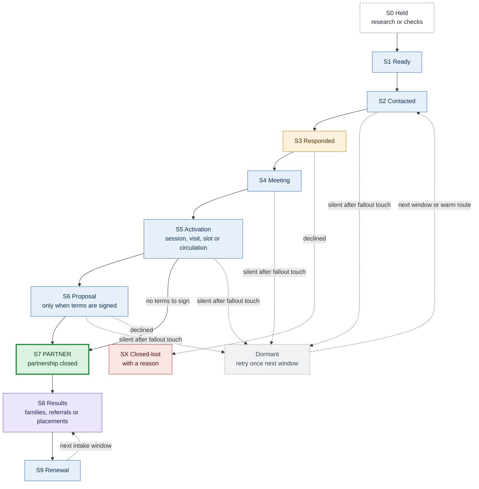

| Stage | Purpose | Entry trigger | Exit trigger | Shared outcome codes |
|---|---|---|---|---|
| **S0 Held** | Not yet contactable | Research, a check or a hold is open (AQ00, WA00, GA00) | The gap is closed (→ S1), or the record is dropped | `researching`, `check_pending`, `held` |
| **S1 Ready** | Approved to contact | Draft reviewed, route chosen, gates passed | First touch delivered | `ready` |
| **S2 Contacted** | Reach the person who decides | First email, redirect request, call or letter delivered | A human reply (→ S3); or silent after the fallout touches (→ Dormant) | `delivered`, `redirect_sent`, `bounced`, `opted_out`, `no_answer`, `escalated`, `name_obtained` |
| **S3 Responded** | Classify the reply and agree a next step | A human reply | Meeting booked (→ S4), deferred, or declined (→ SX) | `interested`, `details_requested`, `referred`, `not_now`, `declined` |
| **S4 Meeting** | Learn the fit and agree the format | Call or meeting booked | Activation agreed (→ S5), proposal requested (→ S6), no fit (→ SX), or silent (→ Dormant) | `booked`, `held`, `rescheduled`, `no_show`, `no_fit` |
| **S5 Activation** | Reach the audience, or prove the fit | Session, visit, slot or circulation confirmed in writing | Held or circulated (→ S7 or S6), or silent (→ Dormant) | `booked`, `held`, `cancelled`, `attendance_recorded`, `circulated` |
| **S6 Proposal** | Put terms in writing (only when the win is a signature); the only stage where an approved incentive may appear ([section 6](#6-the-partnership-offer-and-incentives)) | Proposal sent | Accepted (→ S7), rejected (→ SX), or silent (→ Dormant) | `sent`, `revised`, `accepted`, `rejected` |
| **S7 Partner (win)** | **The partnership is closed** | The segment's win event (see the mapping below) | First result (→ S8) | `circulation_partner`, `benefit_partner`, `sponsorship`, `placement`, `group_rate`, `introduced`, `meeting_held`, `informed` |
| **S8 Results** | Families, referrals or placements coming through | First sign-up, referral or enrolment | Renewal due (→ S9) | `producing`, `dormant` |
| **S9 Renewal** | Keep the partnership going | Before each intake window, or the agreement's review date | Renewed or re-circulated (→ S8), or lapsed | `recirculated`, `renewed`, `repeat_convener`, `lapsed` |
| **SX Closed-lost** | A final exit, only when a human says no or the lead cannot be served | A final lost event | — | One final lost reason (see [side states and reason codes](#side-states-and-reason-codes)) |

**Three rules make the spine work for every segment:**
- **S6 is optional.** A partner whose win needs no signature (a circulation partner, a council introduction, a community meeting) goes from S5 straight to S7. The stage is recorded as skipped.
- **Agreement first.** An employer that wants the agreement before any staff session goes S4 → S6 → S7. The staff session then becomes the launch event of S8, and is recorded as `session held` there. Each deal records which order it followed.
- **Nothing is dead.** Silence is not a "no". A silent lead goes to Dormant after its planned fallout touch ([section 5](#5-fallout-and-re-activation)) and is re-tried once at the next intake window. Only a real refusal, an opt-out or a lead that cannot be served goes to SX.

### Mapping each segment onto the spine

| Spine | Employers (variant B) | Sponsorship (variant A) | SACCOS | Introducers and welfare networks | Welfare homes and programmes | Welfare funders | Government councils | Government wards and villages |
|---|---|---|---|---|---|---|---|---|
| S0 Held | AQ00 hold; public bodies before the compliance check | AQ00 | AQ00; Kiswahili and Finance checks pending | AQ00 | WA00 | WA00; no verified link to a home | GA00 (councils outside the pilot) | GA00 until the council introduction |
| S1 Ready | Ready | Ready | Ready | Ready | Ready | Ready | Letter ready | Convening request ready |
| S2 Contacted | Contacted: Attn message, redirect request or direct message | Contacted | Letter or call | Contacted | Contacted | Contacted | Letter delivered by hand | Request delivered by hand |
| S3 Responded | Responded | Responded | Responded | Responded | Responded | Responded | Call after 5 working days | Acknowledged |
| S4 Meeting | Call or meeting | Meeting | Committee meeting | Meeting with the secretariat | Placement conversation | Meeting (often video) | Courtesy visit | Meeting with the WEO or VEO |
| S5 Activation | Staff session: site visit, webinar or pamphlet pack | skipped | Members' meeting or AGM slot | Circulation agreed | Safeguarding visit | skipped | skipped | Slot agreed in writing |
| S6 Proposal | Benefit proposal (only for a signed agreement) | Sponsorship proposal | Group-rate proposal (optional) | Member-benefit MOU (optional) | Placement proposal | Sponsorship proposal tied to the home | skipped | skipped |
| **S7 Partner** | **Circulation partner or benefit partner** | **Sponsorship agreement** | **Committee circulates, or slot held** | **First circulation done** | **Placement agreement** | **Sponsorship agreement** | **Introduction recorded** | **Community meeting held** |
| S8 Results | Staff sign-ups enter the parent funnel | Sponsored students enrolled | Member sign-ups enter the parent funnel | Referred employers or homes | Children enrolled through admissions | Students enrolled through the home | Ward and village funnels open | Parent opt-ins enter the parent funnel |
| S9 Renewal | Re-circulation each window; agreement review | Reporting and renewal | Re-circulation | Next circulation | Renewal 8 weeks before intake | Reporting and renewal | Re-verify after reshuffles | Repeat convener |

District and regional offices only receive a courtesy notice: S0 → S2 → S3 → S7 `informed` (funnel G3).

### Mapping the older stage names

Three earlier documents named partner stages differently. This table shows where each name now sits, so the conflicts are resolved in one place.

| Spine | Process Map, partner stages | Process Map, workflow | Welfare plan (F14, `account_pipeline`) | Government plan (office stages) | Acquisition tracks |
|---|---|---|---|---|---|
| S0 Held | — | Identify partner | (WA00) | (GA00) | AQ00, WA00, GA00 |
| S1 Ready | Prospect | Identify partner | — | `prospect` | AQ01 or AQ02; WA01 or WA02; GA01 or GA02 chosen |
| S2 Contacted | Contacted | Outreach | `contacted` | `letter_sent` (council); `convening_requested` (ward or village) | — |
| S3 Responded | Engaged | — | `contacted` (reply received) | — | — |
| S4 Meeting | Engaged | Meeting | `needs_assessed` | — | — |
| S5 Activation | Negotiating | Activation (moved earlier) | `visit_held` | `convening_agreed` | — |
| S6 Proposal | Negotiating | Proposal | `proposal` | — | — |
| S7 Partner | Active | Agreement / MOU | `placement` | `introduced` (council); `event_held` (ward or village) | — |
| S8 Results | Producing Results | Leads / referrals | `placement` (place counts) | `event_held` counts (opt-ins) | — |
| S9 Renewal | (Relationship management) | Relationship management | `renewal` | `repeat_convener` | — |

**How the conflicts are resolved:**
- The Process Map puts activation after the agreement. The spine allows both orders, and records which one each deal followed.
- The Process Map's "Active" needs an agreement. The spine also counts a confirmed circulation as a win, because it is the partner's commitment and is in its control.
- The welfare and government plans keep their own stage names inside their tracks, so nothing in those plans is lost. Reports roll them up to spine stages.

### Side states and reason codes

Two side states sit outside the stages:
- **Deferred:** the other side said "not now" and gave a date. The deal keeps its stage and gets a next-action date.
- **Dormant:** silent after the planned fallout touch, or a partner with no new results for two intake windows. It is re-tried **once** at the next intake window (September for January primary, May for mid-year), or sooner through a warm route. After that retry it stays dormant, and reopens only on a new trigger: a reply, a referral, a newly named contact or an association introduction.

| Dormant reason (re-tried once) | Meaning |
|---|---|
| `dormant_no_route` | General inbox: the redirect request, front-desk call and (for the nearest P1/P2 leads) hand-delivered letter gave no name or route |
| `dormant_no_response` | Named person: the follow-up, the redirect-style close and any escalation message got no reply |
| `dormant_details_no_reply` | The outline and two meeting slots, plus one check-in, got no reply |
| `dormant_deferred_expired` | The deferred date passed, and the one message on that date got no reply |
| `dormant_after_meeting` | After the meeting, the summary, the easiest option and the proposal went unanswered |
| `dormant_after_session` | After the session, the sign-up count and the request for one circulation went unanswered |
| `dormant_quiet_partner` | A partner with no new results for two intake windows |

| Final lost reason (SX) | Meaning |
|---|---|
| `declined` | A human said no |
| `suppressed` | Opt-out, or a request not to be contacted |
| `not_relevant` | No staff, members or children the offer can serve near a campus |
| `closed_or_moved` | The organisation closed or left the catchment |
| `duplicate` | Merged into another record |
| `capacity` | Silverleaf cannot serve the request (level, place or need) |
| `compliance_blocked` | A compliance, HR or protocol check failed |
| `terms_not_agreed` | The proposal was explicitly rejected (silence after a proposal is dormant, not lost) |
| `rate_not_approved` | SACCOS: Finance did not extend the member rate (OF07) |
| `safeguarding_stop`, `needs_not_supported` | Welfare only |
| `payment_requested`, `lists_offered` | Government only: stop and escalate; offered lists are refused and recorded |

A hard bounce is not a lost reason. It marks the route invalid and sends the lead back to the redirect step through another route. An election campaign period pauses government work: the deal is deferred to the period's end, not lost. A funder with no verified link to a home stays at S0 (`funder_no_link`).

<!-- contents -->

## 2. All segments at a glance

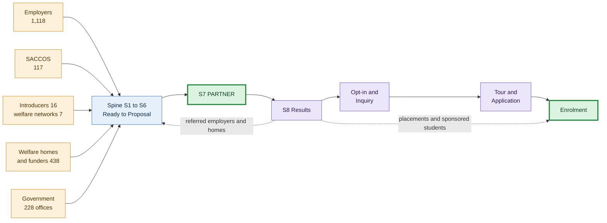

Introducers feed employers and homes back into the spine. Welfare placements and sponsored students reach enrolment through admissions, without a parent opt-in. Every other result reaches the parent funnel through a self-made opt-in.

**Counts** come from read-only copies of the three databases, refreshed on the evening of 11 October 2026 after the T1 merge. "Ready" means a draft is ready for review with a usable route today.

| Segment | Subsegment | Leads (ready) | Funnel | Partnership closed when |
|---|---|---|---|---|
| Employers | Safari operators and travel agencies | 480 (432), of which 14 are variant A | [E1](#e1-small-and-field-based-employers) | The employer circulates the sign-up invitation, or signs a benefit agreement |
| | Hotels, lodges and camps | 194 (123) | [E2](#e2-shift-based-employers) | Same |
| | Hospitals and clinics | 188 (37) | [E2](#e2-shift-based-employers) | Same |
| | Manufacturing | 19 (11) | [E2](#e2-shift-based-employers) | Same |
| | Retail | 17 (6) | [E2](#e2-shift-based-employers) | Same |
| | Farms and estates | 14 (3) | [E2](#e2-shift-based-employers) | Same |
| | Aviation | 5 (2) | [E2](#e2-shift-based-employers) | Same |
| | Banks and other companies | 87 (70) | [E3](#e3-office-based-employers-with-an-hr-function) | Same; usually a signed benefit agreement |
| | NGOs and research bodies | 62 (28) | [E3](#e3-office-based-employers-with-an-hr-function) | Same |
| | Colleges and universities | 23 (19) | [E3](#e3-office-based-employers-with-an-hr-function) | Same |
| | International organisations | 10 (9) | [E3](#e3-office-based-employers-with-an-hr-function) | The staff association circulates, or the organisation signs |
| | Public bodies (HR route only) | 19 (12) | [E4](#e4-public-bodies) | An HR circular to staff, or an MOU signed through HR |
| | Variant A: sponsorship | 14 (within safari operators) | [E5](#e5-sponsorship-variant-a) | A signed sponsorship agreement |
| | Savings groups (SACCOS): employer-based 48, community 67, unclassified 2 | 117 (1) | [E6](#e6-savings-groups-saccos) | The committee circulates to members or gives a meeting slot; optionally a group rate |
| Introducers | Chambers (3), employers' associations (5), sector associations (6), HR body (1), other (1) | 16 (16) | [I1](#i1-introducer-funnel) | At least one circulation to member employers |
| Welfare | Residential care (children's homes) | 100 (17) | [W1](#w1-childrens-homes-and-specialised-centres) | A signed placement agreement |
| | Specialised centres | 70 (5) | [W1](#w1-childrens-homes-and-specialised-centres), with a needs-fit gate | Same, for needs Silverleaf can support |
| | Family-based and sponsorship programmes | 164 (25) | [W2](#w2-family-based-and-sponsorship-programmes) | A placement agreement, or the programme circulates to caregivers |
| | Funders | 104 (34) | [W3](#w3-funders) | A signed sponsorship agreement tied to a linked home |
| | Welfare networks | 7 (5) | [I1](#i1-introducer-funnel) (see [welfare networks](#welfare-networks)) | At least one circulation to member homes |
| Government | Pilot councils (Arusha City, Arusha District, Hai, Meru) | 4 (4) | [G1](#g1-councils) | The council introduces Silverleaf to its WEOs and VEOs |
| | Other councils (Moshi Municipal, Moshi District, Siha, Monduli, Simanjiro) | 5 (0) | [G1](#g1-councils), after the pilot | Same |
| | Ward offices | 129 (0) | [G2](#g2-ward-village-and-mtaa-offices) | A community meeting is held at which Silverleaf speaks to parents |
| | Village offices | 80 (0) | [G2](#g2-ward-village-and-mtaa-offices) | Same |
| | Mtaa offices | 0 recorded (a gap) | [G2](#g2-ward-village-and-mtaa-offices) | Same |
| | District commissioner and regional offices | 7 + 3 (0) | [G3](#g3-district-and-regional-offices) | Informed (no request is made) |

---

## 3. The parent funnel hand-off

Every funnel that reaches parents ends here. Admissions owns each family from the opt-in onward.

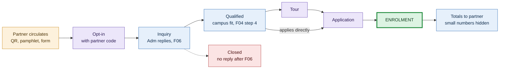

| Step | What happens | Flow | Who |
|---|---|---|---|
| Opt-in | The person signs up: QR code, link or paper form, carrying a partner code | Staff opt-in form (new); VM16 for events | The person themselves |
| Inquiry | Acknowledged the same working period (next working day at most); age or grade and travel area asked; a reminder after 2 working days; a close after 5 more | F06 steps 1–3 | Adm |
| Qualified | Campus fit confirmed; visit slots or the application step offered | F04 step 4 | Adm |
| Tour, Application, Enrolment | Recorded as they happen | F04 step 5 | Adm |
| Report | Totals per partner code go back to the partner each term | F04 step 5; VM17 | Coord |

**The opt-in form** (for review by the data protection officer, aligned with the government plan's form):
- name;
- phone, and whether WhatsApp is preferred;
- email (optional);
- area of residence;
- level of interest (daycare, pre-primary or primary);
- preferred campus (Usa River, Arusha City, Kijenge, Ilboru, Boma Ng'ombe, or "not sure");
- preferred language;
- consent statement and date;
- partner code, filled in from the QR link or printed on the paper form.

The form asks for the level of interest, never a child's name or age, so it holds no children's data. Admissions asks about the child later, within a relationship the parent agreed to.

**Consent wording (a draft for the data protection officer, in Kiswahili and English):** "I agree that Silverleaf Academy may contact me by phone, WhatsApp or email about school admissions. [My employer / the organisation that shared this] will not see my details; Silverleaf will share only total numbers. I can withdraw at any time by replying STOP or calling [admissions number]."

**Partner codes:**
- `EMP-` employer;
- `SAC-` savings group;
- `INT-` introducer;
- `WEL-` welfare programme circulation;
- `EVT-` government community event.

A code is not personal data. It travels with the family in the consented parent store and in admissions records. The lead databases hold only totals per code per month.

**Rules:**
- Staff, members and parents opt in themselves. No partner ever hands over a list of people (Personal Data Protection Act 2022).
- Parent data never enters the repository or the three lead databases.
- Until the consented store is live, run inbound-only. Hand out material with the admissions number and the application link, and ask families to quote the partner code.
- Reports to partners show totals only, and any count of 1 or 2 is shown as "fewer than 3".

---

## 4. First touch: reach the right person

*Approved by the user on 11 October 2026.*

**Why.** We want relevance, not ambiguity. An ambiguous request sent to a general inbox (info@, admin@) is more likely to be ignored, and may never reach the person who can decide. So the first job is to reach the decision-maker for staff benefits: HR, the welfare officer, the COO, or whoever handles staff benefits and rewards.

### The three cases

| Case | Band | First touch |
|---|---|---|
| **A. A named person, with their own address** | High, direct | The meeting request goes straight to them, as now |
| **B. A named person, but only a general inbox** | High, indirect | The full message goes to the general inbox, explicitly addressed to the person (the Attn format below) |
| **C. No named person, only a general inbox** | Medium, or any route with no name | A short redirect request, not the pitch (below). A reply or a forward gives a name, and the lead moves to case B or A |

**Case B: the Attn format.**

```text
Subject: Attn: <Full Name>, <Role> – staff education benefit

For the attention of <Full Name>, <Role>. If this inbox does not reach them, we would be grateful if it could be forwarded.

Dear <Full Name>,

<the letter, written exactly as if to their own address>
```

- The routing line sits at the very top, set apart from the letter by a blank line. It is worded to read naturally both to whoever opens the inbox and to the person once forwarded.
- It uses the person's name, not "he" or "him", unless a source gives the pronoun.
- No honorifics (Mr, Ms, Dr) unless a source states the title.
- **The MD or owner is named, but a large company's HR head is not.** Address both. The routing line becomes: "For the attention of <Full Name>, <Role>, or your HR lead. If this inbox does not reach them, we would be grateful if it could be forwarded." The letter still opens "Dear <Full Name>,". Decision 21 sets what "large enough" means.

**Case C: the redirect request.** It has one line on what the message is about, the ask, and nothing more.

```text
Subject: Staff education benefit – who should we write to?

Hello,

I am writing from Silverleaf Academy in Arusha about a staff education benefit for the children of <Organisation>'s employees.

Who looks after staff welfare and benefits (HR, the welfare officer or the COO)? We would like to send them a short note.

Thank you,
<Sender name>
<Sender role>, Silverleaf Academy
```

Any name or address the front desk gives, by reply, forward or phone, is recorded with that as its source and the date (for example "front-desk reply, 14 October 2026"). The lead then moves to case B, or case A if the address is the person's own.

### Adapting the rule by segment

| Segment | Decision-maker to reach | Case B subject ending | Case C ask |
|---|---|---|---|
| Employers (variant B) | HR, the welfare officer, the COO, or whoever handles staff benefits and rewards | "– staff education benefit" | As above |
| Employers (variant A) | The owner, MD or whoever runs the company's giving | "– student sponsorship" | "Who looks after the company's community giving? We would like to send them a short note." |
| Public bodies | The HR head, after the compliance check | "– staff education benefit" | "Who heads human resources? We would like to send them a short note." |
| Welfare homes and programmes | The head of the home or programme | "– education of the children in your care" | "Who leads the home (or the programme) and looks after the children's schooling? We would like to send them a short note." |
| Welfare funders | The programme officer for Tanzania | "– student sponsorship" | "Who is the programme officer for your work in Tanzania? We would like to send them a short note." |
| Introducers and welfare networks | The executive secretary or CEO | "– an education benefit for your members" | "Who looks after member benefits and communications (the executive secretary or CEO)? We would like to send them a short note." |
| SACCOS | The committee chair or secretary | Kiswahili wording, to be drafted and reviewed by a native speaker | The same request in Kiswahili, reviewed by a native speaker (most SACCOS have no email, so the call script carries it) |
| Government | **Does not apply.** Letters are delivered by hand and addressed to the office holder by title, under Tanzanian protocol | — | — |

The case C opening line ("I am writing from Silverleaf Academy in Arusha about …") by segment: employers and public bodies, "a staff education benefit for the children of <Organisation>'s employees"; variant A sponsors and welfare funders, "sponsoring students' education at Silverleaf"; welfare homes and programmes, "the education of the children in <Organisation>'s care"; introducers and networks, "an education benefit for <Organisation>'s members" (approved 12 October 2026).

### First touch by confidence band

Counts are from the copies refreshed after T1, before shared inboxes are collapsed. The band rules are in `scripts/messaging/export_resend_contacts.py`.

| Band | Employers | SACCOS | Introducers | Welfare | Case | First touch | If silent |
|---|---|---|---|---|---|---|---|
| **High, direct** | 34 | 0 | 3 | 13 | A | Meeting request to the person's own or role address (F01) | Named-person fallout ([section 5](#5-fallout-and-re-activation)) |
| **High, indirect** | 221 | 0 | 9 | 61 | B | The Attn message to the general inbox (F01) | Named-person fallout |
| **Medium** | 360 | 0 | 4 | 10 | C | Redirect request (AQ01) | General-inbox fallout |
| **Low** | 52 | 1 | 0 | 128 | — | Not contacted: held at S0 | Promoted to S1, or dropped |
| **No email (call sheet)** | 451 | 116 | 0 | 233 | C by phone | A front-desk call asking the redirect question; the first message follows "as discussed" | General-inbox fallout (call, then a letter for the nearest P1/P2 leads) |
| **Government** | — | — | — | — | — | Formal Kiswahili letter by hand (F15) | Call after 5 working days, then a courtesy visit |

**Order of work.** January primary applications run from October to December, and daycare and pre-primary enrol at any time. Sessions held in October and November therefore matter most this year. Recommended first wave:
- the P1 employers (100);
- the introducers (16);
- welfare high-priority organisations with a route;
- the four pilot councils.

---

## 5. Fallout and re-activation

*Approved by the user on 11 October 2026.*

Every stall has one planned next touch and then a defined exit. Nothing is "dead": a silent lead becomes dormant, and is re-tried once at the next intake window. This keeps within F01's limit of three messages per sequence.

| Spine stage | Stall | Next touch | Then |
|---|---|---|---|
| S2 | Contacted, no reply (general inbox) | Redirect request → a front-desk call after 2 working days, asking for the HR or welfare officer's name and email → a hand-delivered letter for the nearest P1/P2 leads | Dormant, `dormant_no_route`; re-tried once at the next intake window |
| S2 | Contacted, no reply (named person) | A follow-up with a few offer details from the offer register → a close with a redirect-style ask ("If this sits with HR, who should I write to?") → one message to the escalation contact, if one exists | Dormant, `dormant_no_response`; re-tried at the next window |
| S3 | "Send details" | The one-page outline plus two proposed meeting slots | One check-in, then dormant (`dormant_details_no_reply`) |
| S3 | "Not now" | Record their date; one message on that date | Dormant if silent (`dormant_deferred_expired`) |
| S3 | Referred to a colleague | Restart at S2 with the new person, mentioning who referred us | — |
| S4 | Meeting held, no session booked | A written summary plus the easiest option: a 20-minute webinar or a pamphlet pack | A proposal, then dormant (`dormant_after_meeting`) |
| S5 | Session held, no circulation or agreement | Share the session's sign-up count; ask for one circulation | Dormant until the next window (`dormant_after_session`) |
| S8 | A partner with few sign-ups | Ask them to re-circulate before the next intake (September or May); offer a campus visit day | Dormant after two quiet windows (`dormant_quiet_partner`) |

**Warm routes.** For an employer that is a member of an association, an association circulation or introduction is a fallout option at any stage. For example:
- TATO for safari operators;
- HAT for hotels;
- TBA for banks;
- TAHA for farms;
- APHFTA for health facilities;
- CTI for manufacturers;
- the chambers for everyone.

A warm route can reopen a dormant lead before the next window. It counts as a new trigger, not as a retry.

**Segment variations:**

| Segment | What changes in the fallout |
|---|---|
| Public bodies | The front-desk call goes to the HR office or registry. Never escalate to political or board heads. |
| Variant A sponsors | No offer details in the follow-up. The register gives sponsorship no offer message until a reply, and T1 has blanked these follow-ups until approved copy exists (F20). |
| SACCOS | A call to the chair or secretary, then a hand-delivered Kiswahili letter. The ward community development officer is a warm route. Dormant until the society's next members' meeting or AGM. |
| Welfare homes and programmes | A call to the home's office, then a letter left at the office. Never an unannounced visit inside a home: visits follow the safeguarding protocol. Dormant until the next intake window or the home's budget date. |
| Welfare funders | Mostly abroad: email only, with no call or letter. The redirect asks for the programme officer. Dormant until the funder's next budget cycle. |
| Introducers | A call to the secretariat. Warm route: an introduction from a member employer that is already a partner. |
| Government | Letters by hand: a call after 5 working days, then a courtesy visit. If still silent, re-deliver once before the next quarterly ward or village meeting. Pause during an election campaign period, and never press. |

---

## 6. The partnership offer and incentives

*Approved by the user on 11 October 2026.*

There are two different things here, and they must not be mixed.

1. **The partnership offer.** These are the terms the offer register records: the staff school-fee benefit (OF04), the welfare partner rate (OF03), the member-association rate (OF07, once Finance extends it) and the family offer (OF01, OF02, OF09). They are stated plainly once the conversation is open: in the offer message (follow-up 1), in a reply, or in the meeting. They never appear in the first message.
2. **A promotional incentive.** This is anything extra used to tip a decision, such as discounted first months or a waived fee beyond what the register records.
   - It **never** appears in any automated or standard flow, nor in a cold or early message (S1–S5), because it makes Silverleaf look desperate.
   - It may be used **only at the proposal stage (S6)**, and only for a specific employer that has already engaged.
   - It needs **Finance's written approval each time**, is **time-limited** (with an expiry date), and uses **only terms the offer register records**. An incentive is entered in the register, with its approval and expiry, before any proposal states it.
   - The Rivertrees terms (OF08) are the model: negotiated after a meeting, quoted only to that employer.

---

## 7. Employers

**Size:** 1,118 companies (752 ready) plus 117 savings groups. Variants: B 1,079, A 14, not yet assigned 25 (new leads). Reach tiers: P1 100, P2 150, P3 853, held (X) 15.

### Rules shared by every employer funnel

- **Goal and offer.** Staff hear about Silverleaf through their employer and choose to sign up. The first message asks for a meeting and states no terms (section 4 sets how it reaches the right person). Follow-up 1 states the staff school-fee benefit at no cost to the employer (OF04), and the family offer (OF01, OF02, OF09). The employer may present the benefit as its own or add to it. Terms come only from the [offer register](../../skills/silverleaf-outreach/references/offer-register.md), and Finance confirms each for 2027 before it is sent. Incentives follow [section 6](#6-the-partnership-offer-and-incentives).
- **The win (S7).** One of two forms:
  - **Circulation partner:** the employer agrees in writing (an email is enough) to circulate the invitation, pamphlet or QR code, and confirms the first circulation has gone out.
  - **Benefit partner:** an education-benefit agreement is signed by the CEO, modelled on the Rivertrees proposal (OF08) but with register terms only.
- **Staff session format,** chosen from the staff count the employer gives at the meeting (only 19 companies publish one):

  | Staff at one site within 25 km of a campus | Format |
  |---|---|
  | 20 or more (or 10 or more within 10 km) | Site visit: a 20–30 minute talk with questions, pamphlets and the QR code |
  | Staff on several sites, on shifts that cannot meet, or mostly in the field | Recorded webinar, plus a pamphlet and QR pack for each site |
  | Fewer than 10 | Pamphlet and QR pack, plus an invitation to a shared session: a monthly "employer families" session at the nearest campus, or a cluster session through an introducer |
- **Notice period.** A routine session with the standard, pre-approved assets needs 7 days' notice. A bespoke event (a stall at a family day, co-branded material) follows the event SOP's T-21 clock.
- **OF04 eligibility without a staff list.** The parent declares the employer and role on the application. HR confirms employment and grade for that one person, with the parent's consent.
- **Records, timing and metrics:** see sections [11](#11-what-is-recorded), [12](#12-timing-and-stall-rules) and [13](#13-metrics).

### E1 Small and field-based employers

**Subsegment:** safari operators and travel agencies. Mostly small offices, with guides and porters often in the field or seasonal; the decision-maker is usually the founder or MD. The 14 variant A sponsorship rows follow [E5](#e5-sponsorship-variant-a) instead.

<!-- pair -->
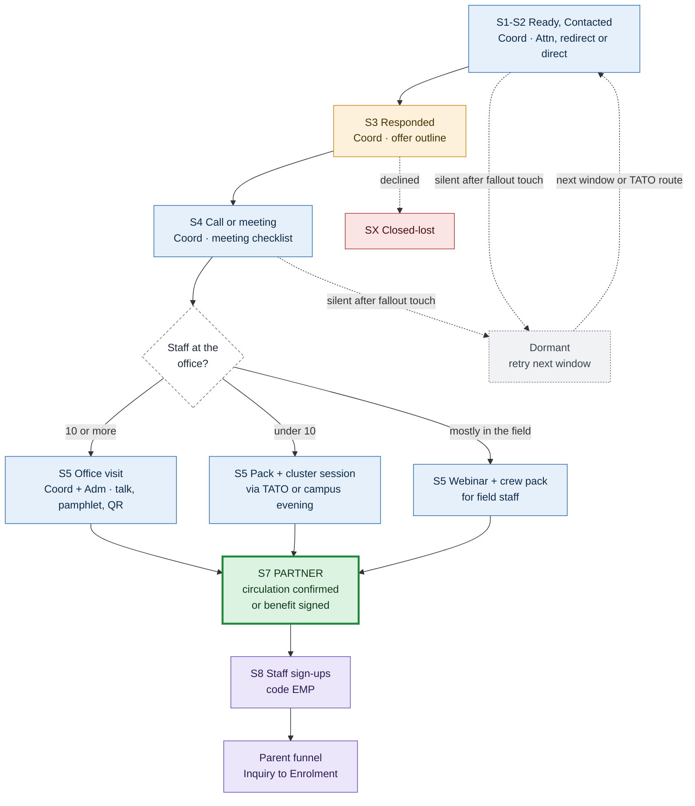

| Funnel facts | E1 |
|---|---|
| Leads (ready) | 480 (432), of which 14 are variant A (E5) |
| Tiers P1 / P2 / P3 / X | 36 / 8 / 421 / 15 |
| First touch: high-direct / high-indirect / medium / low / call sheet | 22 / 166 / 227 / 40 / 25 |
| Gates | Finance confirms OF04 before follow-up 1; session format by staff count |
| Win | S7: circulation confirmed, or benefit agreement signed |
| Dormant | `dormant_no_route`, `dormant_no_response`, `dormant_after_meeting`, `dormant_after_session` |
| Closed-lost | `declined`, `not_relevant`, `closed_or_moved`, `terms_not_agreed`, `suppressed` |
| Hand-off | Each sign-up goes to Adm, then F06 and F04 steps 3–5 |

| Stage | Silverleaf | The employer | Asset |
|---|---|---|---|
| S1–S2 | Coord sends the Attn message, the redirect request or the direct message, or calls | Reads, forwards or replies | First message in the section 4 format; follow-ups |
| S3 | Coord answers the same or next working day (F02) | Says what they want | One-page offer outline (new) |
| S4 | Coord; campus head where convenient | Staff numbers in town and in the field; crew WhatsApp group; who approves | Meeting checklist (new) |
| S5 | Coord + Adm present; or a pack is sent | Hosts or circulates | Pamphlet with QR code (Kiswahili and English); talk or webinar deck; sign-up form |
| S7 | Coord; Fin confirms terms; CEO signs a benefit agreement | Circulates; signs | Circulation confirmation email; benefit agreement template |
| S8–S9 | Adm handles each family; Coord the account | Re-circulates before each intake window | Partner report (totals) |

**Why this group differs:** TATO lists 388 of these operators as members. A cluster session through TATO reaches many small offices at once, and is also their warm route when a lead goes dormant.

### E2 Shift-based employers

**Subsegments:** hotels, lodges and camps; hospitals and clinics; manufacturing; retail; farms and estates; aviation. They share one funnel because staff work in shifts and cannot all leave their posts. The session is timed to shift handover, or recorded. Small sites (most clinics, small shops) get a pamphlet pack instead.

<!-- pair -->
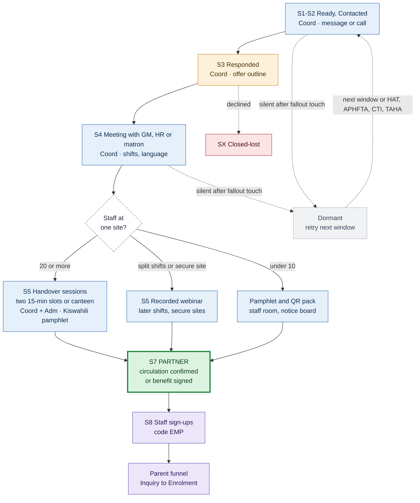

| Funnel facts | E2 |
|---|---|
| Leads (ready) | 437 (182) across six subsegments |
| Biggest first-touch need | 339 have no email, so the front-desk call comes first (50 hotels and 18 hospitals and clinics publish a phone) |
| Gates | Finance confirms OF04; session format by staff count; secure sites need the employer's clearance |
| Win | S7: circulation confirmed, or benefit agreement signed |
| Dormant | `dormant_no_route`, `dormant_no_response`, `dormant_after_meeting`, `dormant_after_session` |
| Closed-lost | `declined`, `not_relevant`, `closed_or_moved`, `terms_not_agreed`, `suppressed` |
| Hand-off | Each sign-up goes to Adm, then F06 and F04 steps 3–5 |

| Subsegment | Leads (ready) | P1 / P2 / P3 | Bands: hd / hi / med / low / none | What changes, and why |
|---|---|---|---|---|
| Hotels, lodges and camps | 194 (123) | 5 / 87 / 102 | 1 / 10 / 56 / 4 / 123 | Two 15-minute slots at the morning and afternoon handovers, or a table in the staff canteen. Leave pamphlets in the staff room. Ask the GM about the quiet season. HAT is the introducer. |
| Hospitals and clinics | 188 (37) | 27 / 1 / 160 | 1 / 6 / 10 / 0 / 171 | Hospitals: a staff-room session at handover, or a recorded webinar, through HR or the matron. Clinics and dispensaries (about 150, mostly from map data, mostly without a route) get the pamphlet pack. Faith-based hospitals may also be linked to welfare homes. APHFTA and CSSC are the introducers. |
| Manufacturing | 19 (11) | 1 / 3 / 15 | 0 / 1 / 5 / 0 / 13 | A canteen session at shift change, in Kiswahili, through HR or the workers' committee. Stress the four instalments (OF09). CTI is the introducer. |
| Retail | 17 (6) | 0 / 5 / 12 | 0 / 0 / 2 / 0 / 15 | A short store huddle and a staff-room QR poster. A chain's head office may approve (escalation contact). |
| Farms and estates | 14 (3) | 0 / 2 / 12 | 0 / 0 / 1 / 0 / 13 | An on-site session during a break, through the welfare officer, in Kiswahili. Workers are often housed on site, far from a campus. Never promise transport (VM12 is not approved). TAHA is the introducer. |
| Aviation | 5 (2) | 0 / 1 / 4 | 0 / 0 / 1 / 0 / 4 | Secure sites: a webinar, or a session off site or in a landside canteen, with any clearance arranged by the employer. |

Roles and assets are the same as in E1. The difference is that the pamphlet and session are in Kiswahili first for factory, farm and retail staff.

### E3 Office-based employers with an HR function

**Subsegments:** banks and other companies; NGOs and research bodies; colleges and universities; international organisations. They share one funnel because each has an HR or staff-welfare function and formal benefits. That makes a signed agreement more likely, and some will want it before any session.

<!-- pair -->
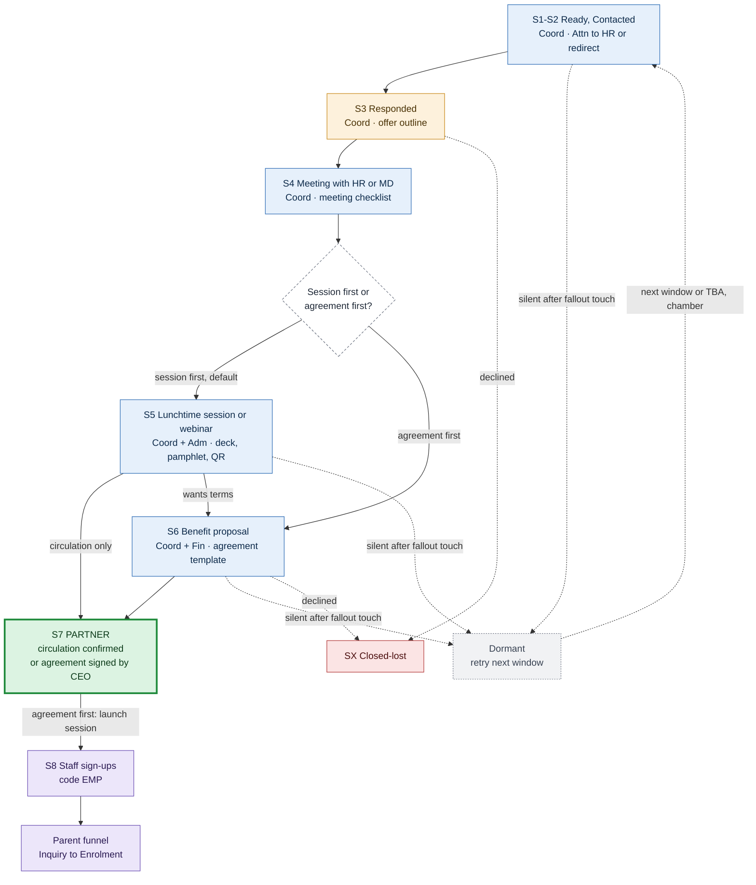

| Funnel facts | E3 |
|---|---|
| Leads (ready) | 182 (126) across four subsegments |
| Gates | Finance confirms the terms; CEO signs any agreement; head-office approval for branch networks; an incentive only at S6 with Finance's written approval |
| Win | S7: circulation confirmed, or benefit agreement signed |
| Dormant | `dormant_no_route`, `dormant_no_response`, `dormant_after_session`, `dormant_after_meeting` |
| Closed-lost | `declined`, `terms_not_agreed`, `compliance_blocked`, `suppressed` |
| Hand-off | Each sign-up goes to Adm, then F06 and F04 steps 3–5 |

| Subsegment | Leads (ready) | P1 / P2 / P3 | Bands: hd / hi / med / low / none | What changes, and why |
|---|---|---|---|---|
| Banks and other companies | 87 (70) | 21 / 36 / 30 | 4 / 17 / 37 / 1 / 28 | Branch networks may need head-office approval (escalation contact). Circulate through the intranet or payslips. TBA is the introducer. |
| NGOs and research bodies | 62 (28) | 0 / 2 / 60 | 2 / 9 / 10 / 0 / 41 | Local staff only. Never imply programme funding or endorsement. Some are also welfare funders: run one deal per organisation. |
| Colleges and universities | 23 (19) | 10 / 0 / 13 | 4 / 5 / 5 / 0 / 9 | Go through staff welfare or HR, never the student admissions inbox. Avoid exam periods. Combine with a staff SACCOS where one exists. |
| International organisations | 10 (9) | 0 / 5 / 5 | 0 / 2 / 6 / 1 / 1 | Often the staff association or welfare committee is the counterpart, and it circulates. Host-country staff rules apply, and approval is slow. |

### E4 Public bodies

**Subsegment:** public bodies such as agencies, authorities and parastatals, approached only as employers. A public body has its own funnel because of two gates:
- a **compliance check** before S1;
- **HR approval** before any session or agreement.

The benefit is never combined with a request for official action (OF04 restriction). The first touch is the Attn format to the HR head, or a redirect asking who heads HR.

<!-- pair -->
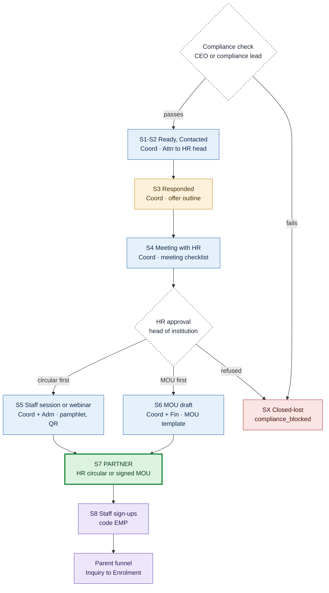

| Funnel facts | E4 |
|---|---|
| Leads (ready) | 19 (12); all P3 |
| First touch: hd / hi / med / low / call sheet | 0 / 5 / 0 / 6 / 8 (the 6 low rows wait for the compliance check) |
| Gates | Compliance check (decision 12); HR approval; CEO signs an MOU; never an incentive to a public body |
| Win | S7: an HR circular to all staff, or a signed MOU |
| Dormant | `dormant_no_route` (the front-desk call goes to the HR office), `dormant_no_response` |
| Closed-lost | `compliance_blocked`, `declined`, `terms_not_agreed` |
| Typical length | 60–90 days from meeting to win |
| Hand-off | Each sign-up goes to Adm, then F06 and F04 steps 3–5 |

**What fails the check:** a body that taxes, regulates, inspects or licenses Silverleaf (for example the revenue authority), or any body with official business pending with Silverleaf.

### E5 Sponsorship (variant A)

**Subsegment:** employers that publish education or community giving. All 14 so far are safari operators. They are asked to sponsor students, at any size (including textbooks, transport or meals). There is no staff session and no opt-in step.

<!-- pair -->
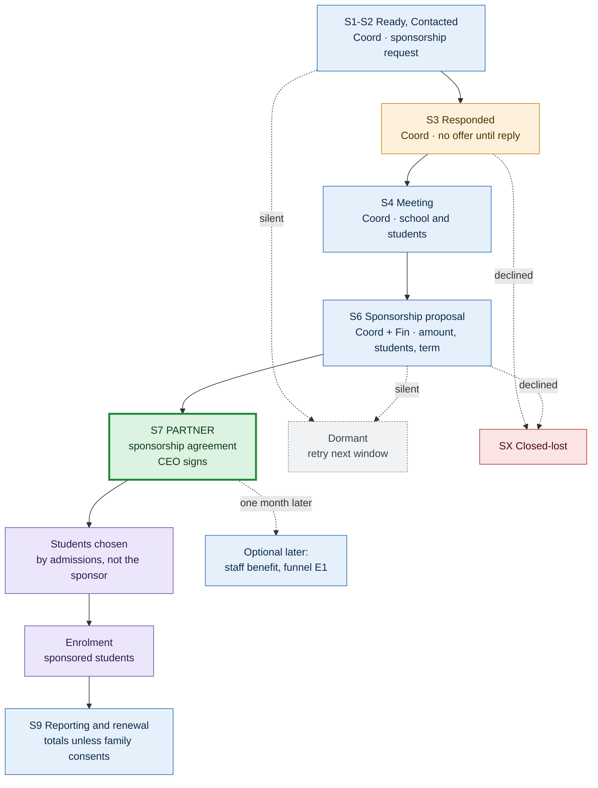

| Funnel facts | E5 |
|---|---|
| Leads | 14 (all safari operators) |
| Gates | No offer message until the employer replies (offer register); CEO signs |
| Win | S7: a signed sponsorship agreement (amount or items, number of students, term, reporting) |
| Dormant | `dormant_no_response`, `dormant_after_meeting` |
| Closed-lost | `declined`, `terms_not_agreed` |
| Hand-off | Admissions chooses and enrols the students (with a welfare partner where relevant) |
| Fixed in T1 | The 14 rows no longer carry staff-benefit follow-ups. They are blank, marked "Sponsorship follow-up awaiting approved copy" (F20 will supply it) |

The staff benefit is offered as a separate conversation one month after the sponsorship is agreed. It is never bundled into the sponsorship ask (decision 3).

### E6 Savings groups (SACCOS)

**Subsegments:** employer- or institution-based SACCOS (48), community or open-bond SACCOS (67), and 2 from map data with no type. The audience is members, reached through the committee chair or secretary, in Kiswahili (F03).

The offer message gives the family offer and the member-association rate. That rate (OF07) is documented for KINEFA only, so Finance must agree to extend it before it is stated. There is no loan, payroll or subsidy claim (VM06).

<!-- pair -->
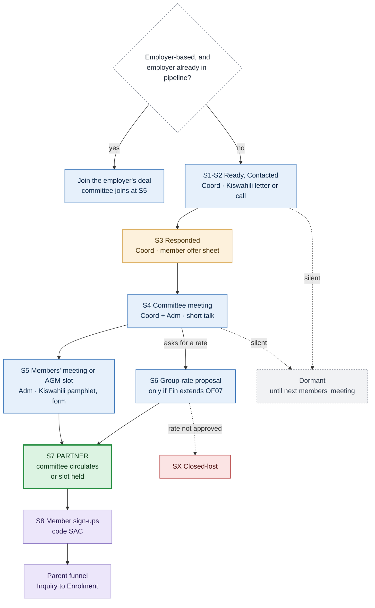

| Funnel facts | E6 |
|---|---|
| Leads (ready) | 117 (1): employer-based 48, community 67, unclassified 2 |
| First touch | 116 have no email, so a call to the chair or secretary or a hand-delivered Kiswahili letter comes first; 1 is low (held) |
| Gates | Kiswahili review and Finance approval of the member rate before S1 |
| Win | S7: the committee circulates to members, or a meeting slot is held; a group rate is a stronger optional form |
| Dormant | `dormant_no_route`, `dormant_no_response` (until the society's next members' meeting or AGM) |
| Closed-lost | `declined`, `rate_not_approved` |
| Hand-off | Each member sign-up goes to Adm, then F06 and F04 steps 3–5 |

| Subsegment | Leads | What changes, and why |
|---|---|---|
| Employer-based SACCOS | 48 | The members are one employer's staff. If that employer is already in a funnel (for example a college and its staff SACCOS), run one combined deal; the committee joins at the session. |
| Community SACCOS | 67 | A broader community membership, so the members' meeting is the main event. Ward community development officers, recorded in the government run, are a possible warm route. |
| Unclassified | 2 | Treated as community until the type is known. |

**Timing:** members' meetings and AGMs follow each society's own calendar. Ask the committee for the next date, and record it as the next-action date. Sign-ups are counted against the group-rate thresholds (50, 100 and 150 students) as totals.

---

## 8. Introducers

### I1 Introducer funnel

**Subsegments:** chambers (TNCC national, Arusha regional and Kilimanjaro regional); employers' associations (ATE national and Northern Zone, CTI national and Arusha/Moshi, TPSF); sector associations (TATO, HAT, TBA, TAHA, APHFTA, CSSC); the HR body (WHAT); and other (EABC). The [welfare networks](#welfare-networks) use the same funnel.

All of them share one funnel. Their win is a circulation to members, and their results are **employer or home leads, not parents**. The first touch goes to the executive secretary or CEO (section 4).

<!-- pair -->
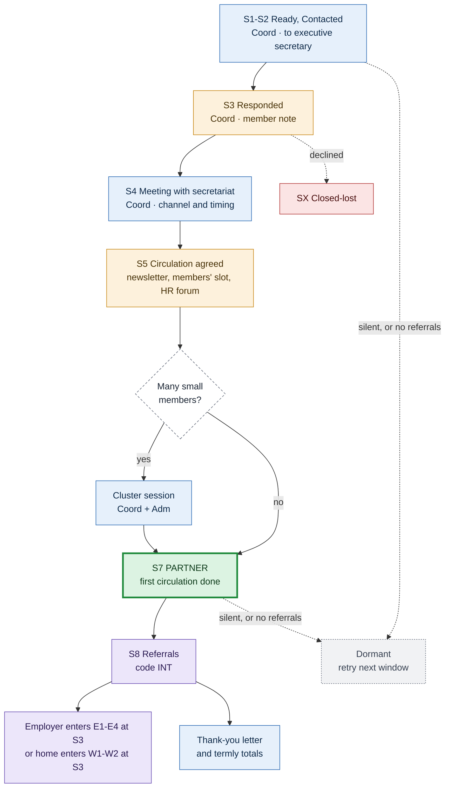

| Funnel facts | I1 |
|---|---|
| Leads (ready) | 16 (16): chambers 3, employers' associations 5, sector associations 6, HR body 1, other 1 |
| First touch: hd / hi / med | 3 (TATO, CTI, CSSC) / 9 / 4 (ATE Northern Zone shares ATE's inbox) |
| Gates | CEO approves any formal member-benefit listing or MOU (optional S6) |
| Win | S7: at least one circulation, such as a newsletter item, a members' meeting slot, an HR forum or introduction emails |
| Dormant | `dormant_no_response`; `dormant_quiet_partner` (no referrals after two circulations) |
| Closed-lost | `declined`, `not_relevant` |
| Hand-off | Referred employers enter an employer funnel at S3 as warm leads. A staff member who signs up straight from a circulation enters the parent funnel under the INT code |

| Kind | Organisations | What changes, and why |
|---|---|---|
| Sector associations | TATO, HAT, TBA, TAHA, APHFTA, CSSC | Each reaches one kind of employer directly: TATO the safari operators (388 recorded members), HAT hotels, TBA banks, TAHA farms, APHFTA private health facilities, CSSC faith-based hospitals and welfare. Ask for a cluster session as well as a circulation. They are also the warm routes in [section 5](#5-fallout-and-re-activation). |
| Chambers and employers' associations | TNCC (3), ATE (2), CTI (2), TPSF | They reach all kinds of employer, through events and HR forums, so plan around their calendar. |
| HR body | WHAT | Its members are HR practitioners, the people who decide benefits. Ask for a speaker slot. |
| Other | EABC | Regional, with little local reach: low priority. |

**Timing:** check referrals 2 and 6 weeks after each circulation. If there are none, ask once for a second channel, then mark the introducer dormant.

**No referral rewards.** OF05 has expired and F11 is blocked until the 2027 scheme is approved, so the acknowledgement is a thank-you letter and termly totals only.

---

## 9. Welfare organisations

**Size:** 445 in scope; 86 drafts are ready. Tracks: WA00 hold 321, WA01 routing 124, WA02 consultative 0 (it needs a licence confirmed by the authority). A welfare lead is an **account that pays fees for the children in its care**, not a channel to parents. These funnels build on F14 in [the welfare plan](../../plans/b2b-welfare-leads-plan.md) §5.6.

### Rules shared by every welfare funnel

- **Offer.** The follow-up gives the partner rate (OF03), the free uniform (OF01) and the instalments (OF09). OF03 applies only when a home places **all** its primary-age children: 3% per child at 10 children, rising to 18% at 60. A smaller home pays standard fees with the family offer. Further institutional terms (VM13) stay blocked until Finance approves a terms memo.
- **Children's data.** The lead databases never hold a child's name, age, photo or story. Admissions assesses each child in Ed-admin with the guardian's written consent. The databases record totals only: age bands discussed, places discussed, agreed and enrolled.
- **Safeguarding.** Two staff on every visit, no photographs, and the DSL informed. A concern stops the deal, nothing is automated, and it is escalated to the DSL.
- **Recipient.** The head of the home or programme on the ground first; for funders, the programme officer. A senior executive abroad is the escalation contact. A chair is used only when no executive is named.

### W1 Children's homes and specialised centres

**Subsegments:** residential care (children's homes) and specialised centres (disability, rescue, street children). They share one funnel because both are the children's guardian and payer. A specialised centre adds one gate, the needs-fit check, before the visit.

<!-- pair -->
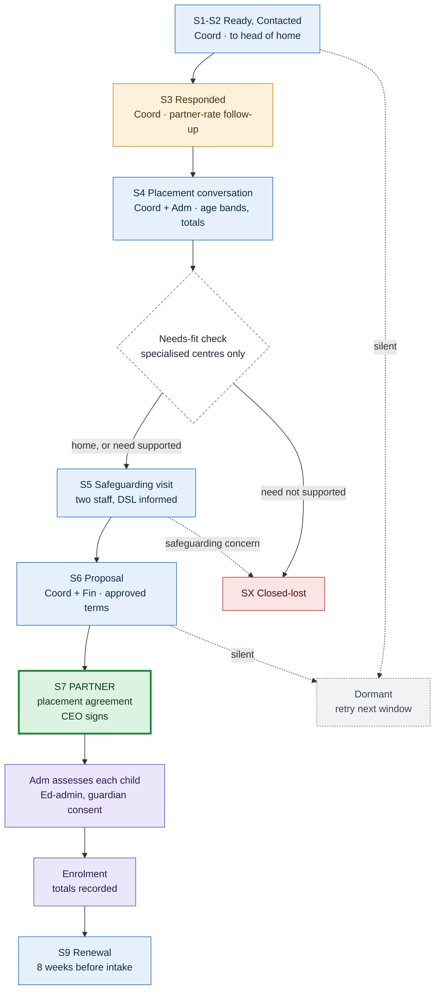

| Funnel facts | W1 |
|---|---|
| Leads (ready) | Residential care 100 (17); specialised centres 70 (5) |
| Priority high / medium / low | Residential 23 / 20 / 57; specialised 3 / 6 / 61 |
| First touch: hd / hi / med / low / call sheet | Residential 3 / 9 / 4 / 38 / 46; specialised 0 / 5 / 0 / 17 / 48 |
| Gates | Needs-fit check (specialised); safeguarding visit protocol; terms memo approved by Fin; CEO signs |
| Win | S7: a signed placement agreement on approved terms |
| Dormant | `dormant_no_route`, `dormant_no_response`, `dormant_after_meeting` (until the next intake window or the home's budget date) |
| Closed-lost | `declined`, `needs_not_supported`, `safeguarding_stop`, `capacity`, `terms_not_agreed` |
| Hand-off | Admissions, child by child, outside the lead databases; no parent opt-in |

| Subsegment | What changes, and why |
|---|---|
| Residential care (children's homes) | The standard path: the home is the guardian and the payer. |
| Specialised centres | A needs-fit check comes first, because Silverleaf must decide which needs it can support well (welfare plan decision 4). Rescue and safe-house locations stay confidential, so no address appears in any shared material. |

### W2 Family-based and sponsorship programmes

**Subsegment:** family-based care, orphans and vulnerable children programmes, and sponsorship programmes. They get their own funnel because the children live with families and may attend many schools, so the decision can sit with the programme, the sponsor or the family.

<!-- pair -->
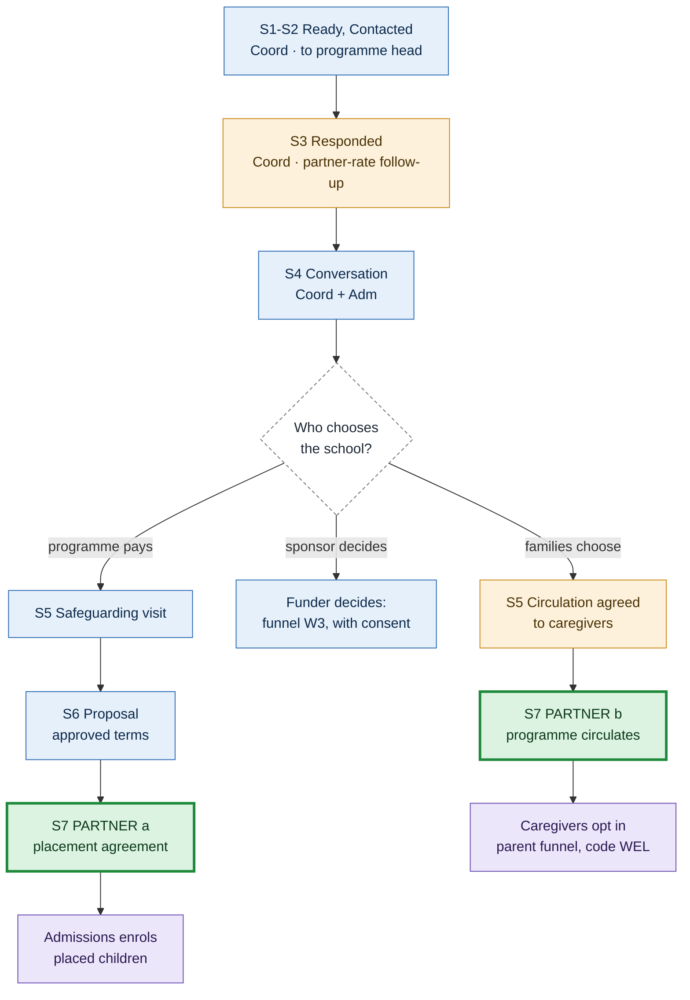

| Funnel facts | W2 |
|---|---|
| Leads (ready) | 164 (25) |
| Priority high / medium / low | 12 / 14 / 138 |
| First touch: hd / hi / med / low / call sheet | 2 / 17 / 5 / 28 / 112 |
| Gates | Who chooses the school; safeguarding visit; the programme's agreement before contacting its funder or caregivers |
| Win | S7: (a) a placement agreement, or (b) the programme circulates to caregivers |
| Dormant | `dormant_no_route`, `dormant_no_response`, `dormant_after_meeting` (the diagram is at its 12-node limit, so these are listed here) |
| Closed-lost | `declined`, `not_relevant`, `terms_not_agreed`, `safeguarding_stop` |
| Hand-off | (a) admissions enrols the placed children; (b) caregivers enter the parent funnel. The form adds no data about children |

OF03's "all primary-age children" condition often does not fit these programmes, so path (a) usually means standard fees with the family offer.

### W3 Funders

**Subsegment:** funders (foreign charities, foundations, corporate giving programmes). Sponsorship is asked only where the run holds a sourced, verified link to a home or programme near a campus. Without that link the draft is held. The first touch goes to the programme officer for Tanzania.

<!-- pair -->
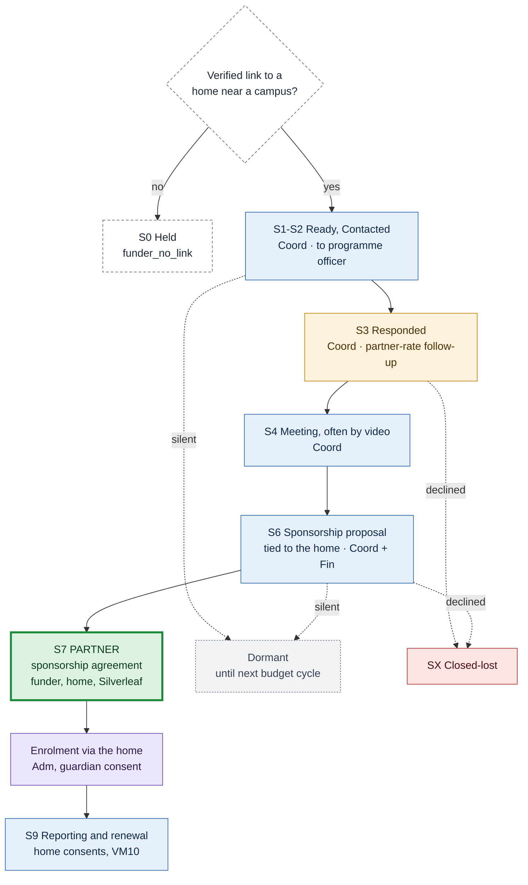

| Funnel facts | W3 |
|---|---|
| Leads (ready) | 104 (34) |
| Priority high / medium / low | 3 / 7 / 94 |
| First touch: hd / hi / med / low / call sheet | 8 / 25 / 1 / 43 / 27 |
| Gates | A verified link to a home; CEO signs; reporting needs the home's consent |
| Win | S7: a signed sponsorship agreement, usually three-way (the funder pays, the home places, Silverleaf teaches) |
| Dormant | `dormant_no_response` (email only; re-tried at the next budget cycle) |
| Closed-lost | `declined`, `terms_not_agreed` |
| Hand-off | Enrolment through the linked home and admissions |

**Why funders differ:**
- Many are abroad, so meetings are by video, across time zones and sometimes languages, and the fallout is email only.
- The decision-maker is often a chair.
- Budget cycles drive timing: record the cycle as the next-action date.
- The follow-up offers the partner rate as "a way to stretch sponsorship".

### Welfare networks

**Subsegment:** welfare networks, bodies that can share the partnership with many homes (7 leads, 5 ready; bands 5 high-indirect, 2 low). They follow the [I1 introducer funnel](#i1-introducer-funnel) exactly. The win is a circulation to member homes, and each home that responds enters W1 or W2 at S3 with the network's code. Government social-welfare offices are never treated as networks; they belong to the government track.

---

## 10. Government offices

**Size:** 228 offices. No letter has been delivered yet, and no community events are recorded. These funnels follow F15 and F16 in [the government plan](../../plans/b2b-government-leads-plan.md) §5.7.

**Goal:** a community meeting at which Silverleaf gives a free 15–20 minute talk in Kiswahili on getting children ready for school, with a parent booklet.
- Silverleaf asks nothing for itself, offers nothing to officials, and never takes lists of residents (OF04 restriction; register rule 5).
- It stays politically neutral: administrative offices come first, and elected leaders are engaged only through the forum they chair.
- The first-touch rule in section 4 does not apply: letters are delivered by hand and addressed to the office holder by title.

### G1 Councils

**Subsegments:** the pilot councils (Arusha City, Arusha District, Hai, Meru) and the other councils (Moshi Municipal, Moshi District, Siha, Monduli, Simanjiro). They share one funnel. The other councils start only after the pilot introductions.

<!-- pair -->
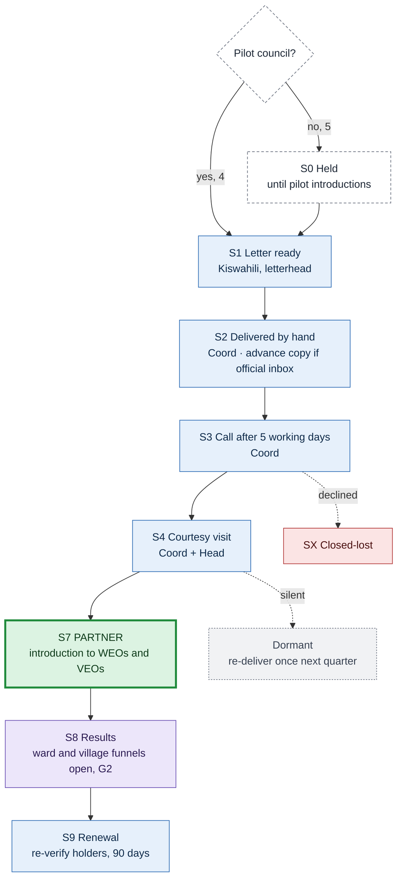

| Funnel facts | G1 |
|---|---|
| Leads (ready) | Pilot 4 (4, GA01); other 5 (0, GA00) |
| Gates | B2G owner informed before any letter; native-speaker review of the letter |
| Win | S7: the council introduces Silverleaf to its ward and village executive officers |
| Dormant | Silent after the call and courtesy visit: re-deliver once the next quarter |
| Closed-lost | `declined`, `payment_requested`; an election period defers |
| Hand-off | None directly: the result is G2 funnels opening |

### G2 Ward, village and mtaa offices

**Subsegments:** ward offices, village offices, and mtaa offices (none recorded yet: a gap). They share one funnel. Only the forum differs:

| Subsegment | Leads | Waves by distance to a campus | Forum |
|---|---|---|---|
| Ward offices | 129 | 57 within 10 km, 35 at 10–20 km, 32 beyond 20 km, 5 not yet located | Ward public meeting convened by the WEO with the councillor; the Ward Development Committee meets at least four times a year |
| Village offices | 80 (36 Hai, 34 Meru, 9 Arusha District, 1 mapped inside Arusha City and flagged) | 29 within 10 km, 41 at 10–20 km, 10 beyond 20 km | Village assembly: all residents aged 18 and over, at least quarterly (confirm the section of the Act before quoting it). VEO administrative; chair elected |
| Mtaa offices | 0 | — | Mtaa meeting (cities have mitaa, not villages) |

<!-- pair -->
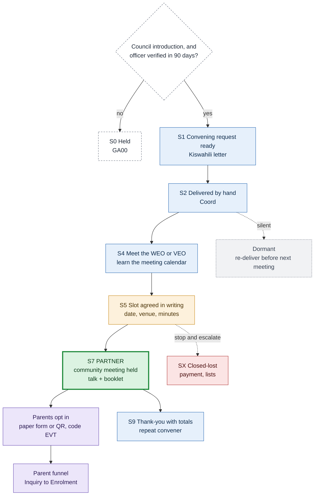

| Funnel facts | G2 |
|---|---|
| Leads (ready) | 209 (0): wards 129, villages 80; all held until a council introduction (GA02 gate) |
| Gates | Council introduction recorded; the post holder verified within 90 days; Kiswahili talk, booklet and form approved once; consented store live, or inbound-only |
| Win | S7: a community meeting held with Silverleaf's talk |
| Dormant | Silent after delivery and a call: re-deliver once before the next quarterly meeting |
| Closed-lost | `declined`, `payment_requested` (stop and escalate), `lists_offered` (refused and recorded); an election period or a cancelled event defers |
| Hand-off | Paper forms are entered into the consented store within 24 hours, then secured or destroyed. Each family then goes to F06 and F04 steps 3–5. Totals by event code come back |

**At the meeting:** two Silverleaf staff (one from admissions) present the talk (VM14) and hand out the booklet (VM15). The voluntary form or QR code (VM16) is offered at the end. There are no photographs, gifts or payments. The office never collects or sees the forms.

**Timing:**
- a routine agenda slot needs 7 days' notice; a bespoke event needs T-21;
- confirm logistics at T-2;
- send a thank-you letter with totals (VM17) within 5 working days;
- pull counts weekly for 8 weeks after each event.

### G3 District and regional offices

**Subsegments:** district commissioner offices (7) and regional offices (3). They receive a courtesy notice only, once the pilot introductions are done and the B2G owner approves. District public meetings are formal and are not a v1 target.

<!-- pair -->
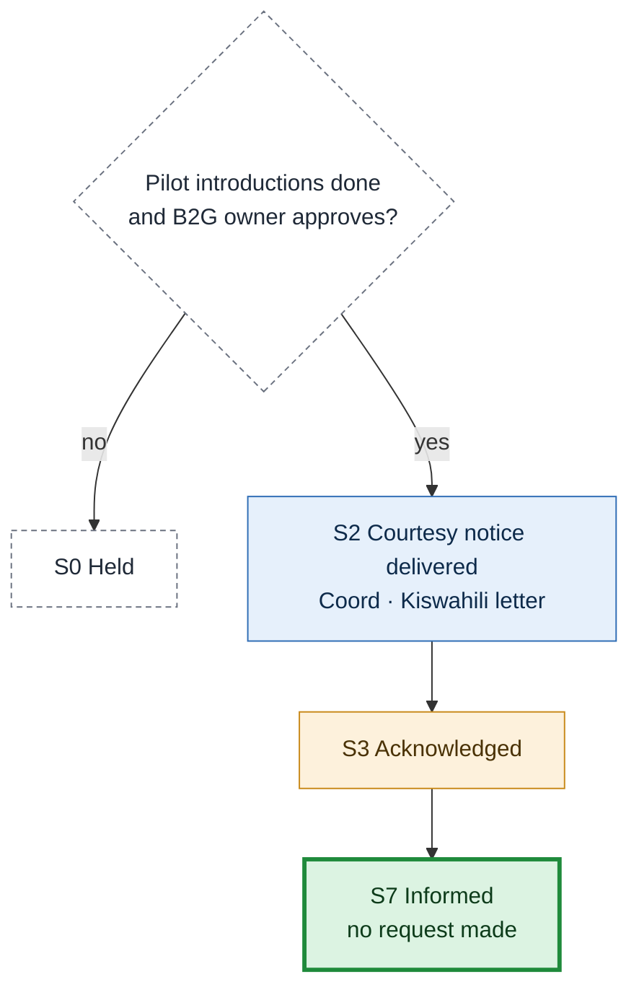

| Funnel facts | G3 |
|---|---|
| Leads (ready) | 10 (0): districts 7, regions 3 |
| Gate | Pilot introductions recorded; B2G owner approves |
| Win | S7 `informed`: no request is made, so there is nothing more to win |
| Closed-lost | Not applicable; an objection is recorded and escalated to the B2G owner |

---

## 11. What is recorded

This is the tracking schema. It holds organisation-level facts and totals only, never a person in the parent funnel.

| Spine stage | Fields |
|---|---|
| Every stage | stage, stage date, owner role, next action, next-action date (required while open), outcome code, band and acquisition track at first touch, first-touch case (A direct, B Attn, C redirect), partner code, touch count, last touch date, escalation used and its date |
| S0 | hold reason, check owner, check due date |
| S2 | first-touch date and channel, sequence (AQ01, AQ02, F03, call sheet or letter), front-desk call date and result; a name or address obtained, with its source and date |
| S3 | reply date, reply type, referred-to role and who referred, deferred-until date |
| S4 | booked and held dates, format, approximate staff or member count as stated (a range), shift pattern, staff channels, language, approver role |
| S5 | type (site visit, handover sessions, webinar, pack, cluster, members' meeting, safeguarding visit, slot), booked and held dates, attendance estimate and method, pamphlets handed out, sign-ups from the session |
| S6 | proposal sent date, offer IDs, Finance confirmation date, version; for an incentive, its register ID, Finance's written approval reference and the expiry date |
| S7 | win type (outcome code), date, approver (CEO where signed), circulation channel and date, agreement reference, renewal-due date |
| S8 | monthly totals per partner code: sign-ups, enquiries, tours, applications, enrolments; welfare: places agreed and enrolled; government: the `community_events` counts |
| S9 | review date, outcome, next window |
| Dormant | dormant reason (the `dormant_` codes), dormant since, retry due (the next intake window, the society's meeting or the funder's budget date), retry used (yes or no), warm route tried |
| SX | final lost reason, date, short note |

Segment additions:
- **Welfare:** age bands discussed (totals), places discussed, the linked home for funders, the visit date and the DSL informed.
- **Government:** letter delivered date, introduction reference, post holder verified date, event code.

---

## 12. Timing and stall rules

The planned touch for each stall is in [section 5](#5-fallout-and-re-activation). This table gives the gaps.

| Spine step | Typical gap | Re-prompt | Then |
|---|---|---|---|
| S2, named (AQ02 / F01) | Day 0, +4, +4 working days, then the escalation message | Built into the sequence | Dormant (`dormant_no_response`) |
| S2, general inbox (AQ01) | Redirect request on Day 0; front-desk call after 2 working days; hand-delivered letter for the nearest P1/P2 leads | Built in | Dormant (`dormant_no_route`) |
| S2, SACCOS (F03) | Day 0, +4, +4 working days (or call, then letter) | Built in | Dormant until the next members' meeting |
| S2, call sheet | Two call attempts on different days, within 5 working days | A letter for the nearest P1/P2 leads | Dormant (`dormant_no_route`) |
| S2, government | Call 5 working days after the letter, then a courtesy visit (F15) | Re-deliver once the next quarter | Dormant |
| S3 → S4 | Answer the same or next working day (F02); details plus two meeting slots; meeting within 10 working days | One check-in | Dormant (`dormant_details_no_reply`) |
| S4 → S5 | Summary plus the easiest option within 2 working days; session within 3–6 weeks (7 days' notice for routine sessions) | A proposal | Dormant (`dormant_after_meeting`) |
| S5 → S6/S7 | Sign-up count and the circulation request within 5 working days | One reminder | Dormant until the next window (`dormant_after_session`) |
| Deferred | The date they gave | One message on that date (F02 step 5) | Dormant (`dormant_deferred_expired`) |
| Dormant retry | The next intake window (September for January primary, May for mid-year), the society's next meeting, or the funder's budget date | One message, through a warm route where one exists | Stays dormant until a new trigger |
| S8 → S9 | Re-circulation before each window; agreements reviewed 8 weeks before the January intake | One reminder plus a campus visit day | Dormant after two quiet windows |
| Welfare | F14: one follow-up after 4 working days (WA02), or one check-in after 5 (WA01) | Budget timing: hold with a dated next action | A licence not confirmed returns the deal to WA00 |
| Government events | T-7 materials (T-21 bespoke), T-2 logistics, thank-you within 5 working days, counts weekly for 8 weeks | — | Pause during an election period; stop on a payment request |

---

## 13. Metrics

| Level | Conversion to watch | Leading indicators |
|---|---|---|
| First touch | Case C redirect → name obtained; case B Attn → reply; case A → reply | Share of leads that reach a named decision-maker; days to a name; front-desk call success |
| Spine | S2 → S3 (reply rate), S3 → S4, S4 → S5, S5 → S7, S7 → first result | Reply rate by band, case and subsegment; days from reply to meeting; meetings and sessions booked per week |
| Fallout | Dormant → reopened (by retry, or by warm route) | Share of dormant leads reopened at each window; warm-route conversion |
| Employers and SACCOS | Session → partner; partner → at least one sign-up | Sign-ups per 100 attendees and per circulation; share of partners re-circulating each window; cost per sign-up |
| Introducers | Circulation → referred employers → referred partners | Referrals per circulation; enrolments traced back through referred employers |
| Welfare | Conversation → visit → proposal → agreement; places agreed → enrolled | Renewal rate; sponsorship value agreed (totals) |
| Government | Letter → introduction → request → meeting held | Attendance; opt-ins per 100 attendees; cost per opt-in; repeat conveners (feeds the ward score's observed-yield factor) |
| Parent funnel | Opt-in → inquiry → tour → application → enrolment, by partner code | Time to first reply; share of opt-ins that give age and area |
| Incentives | Incentives approved and used | Should stay rare: each one is listed with its approval and expiry |

Change one thing at a time (acquisition framework, Measurement).

---

## 14. Existing flows and the gaps

| Stage | Covered by | Note |
|---|---|---|
| S0 → S1 intake and track choice | F12 (named in outreach-flows.md and campaigns C01, C02) | **Not in the flows table**, which holds F01–F11 only |
| S2, named person | F01 | Step changes agreed on 11 October 2026: the Attn format, a redirect-style close and escalation, then dormant ([outreach flows](outreach-flows.md)) |
| S2, general inbox | F13 / AQ01 | Step changes agreed on 11 October 2026: redirect request, front-desk call after 2 working days, letter for P1/P2. **F13 is not in the flows table** |
| S2, SACCOS | F03 | |
| S3 reply handling | F02 | Step changes agreed on 11 October 2026: details with two meeting slots; a referral restarts at S2, naming who referred |
| S5 partner session to opt-in | F04 steps 1–2 | Its 21-day rule is too slow for routine sessions (conflict 3) |
| Parent funnel | F06, then F04 steps 3–5 | |
| Welfare W1–W2 | F14 (welfare plan) | Plan only |
| Government G1–G2 | F15, F16 (government plan) | Plan only |
| Referral rewards | F11 | Blocked |

**Gaps that need new flows (named only):**
- **F17 Meeting to staff session (employers):** format choice, booking, the 7-day light path.
- **F18 Partner agreement:** proposal, Finance and CEO gates, signature, circulation confirmation, renewal; the only flow where an approved incentive may appear.
- **F19 Re-circulation, dormancy and the one retry at the next intake window.**
- **F20 Sponsorship:** variant A and welfare funders, with proposal, agreement, reporting and renewal; it supplies the approved sponsorship follow-up copy T1 left blank.
- **F21 SACCOS committee to members' meeting.**
- **F22 Introducer circulation and referral intake, including warm-route introductions.**
- **F23 Escalation contact.**
- **F24 Front-desk call and call-sheet first touch:** the redirect question by phone, then the "as discussed" email.
- **F25 Partner reporting** (totals, small numbers hidden).

---

## 15. Conflicts with the existing documents

1. **Stage order and names.** The Process Map runs meeting → proposal → agreement/MOU → activation. The user's model runs the staff session first. The welfare and government plans each use their own stage names. *Resolved by the spine and the [older-names table](#mapping-the-older-stage-names).*
2. **The win.** The Process Map's "Active" follows an agreement. The user's model also counts a circulation partner as closed. *Resolved: both are S7 win types.*
3. **Notice period.** F04 step 1 needs at least 21 days before any partner session. The government plan uses 7 days for routine slots with pre-approved materials. *Decided (decision 10): 7 days for routine sessions, T-21 for bespoke events; F04 step 1 to be amended.*
4. **Band and track disagree.** After T1, 236 company and introducer rows in a high band (221 high-indirect, 15 high-direct) are on AQ01 routing, and only 38 chosen rows are on AQ02.

   Under the first-touch rule (section 4), a named person behind a general inbox gets the full Attn message on F01, not the AQ01 routing sequence. AQ01 becomes the redirect request for unnamed routes. *The tracks need re-assigning when the drafts are rebuilt (section 17).*
5. **Variant A follow-ups. Fixed in T1 (merged 11 October 2026).** The 14 chosen sponsorship rows (56 sponsorship plans in all) no longer carry staff-benefit follow-ups. They are blank, marked "Sponsorship follow-up awaiting approved copy". Approved sponsorship copy is still needed (F20).
6. **Empty village names. Fixed in T1 (merged 11 October 2026).** Unnamed village points are no longer imported (they become review items), and drafting refuses an empty place name. The government run now holds 80 village offices, not 82.
7. **Call-to-action labels.** The master's `outreach_plans.cta_type` values ("Welfare referral", "Sponsor referral", "Committee referral", "Information offer", "Format choice") no longer describe the drafts. Every first message now asks for "a short meeting, either in person or by phone". Tracking must not read the CTA from this column.
8. **Flows missing from the table.** F12 and F13 are named but are not in the master's `outreach_flows` table. F14–F16 exist only in the plans.
9. **What government material may say.** The register's JSON rules let convening letters describe the family offer (OF01, OF02, OF09). Its Markdown rule 5 (changed 1 October) says letters state no offer. The government plan's booklet (VM15) lists fees, which the campaign document holds back until the 2027 fees are approved. *Decision 19.*
10. **Who is asked for sponsorship.** The acquisition framework said "Sponsorship is asked of welfare funders only", although employers with published education giving (variant A) have been asked since 1 October. *Corrected in that document on 11 October 2026.*
11. **Escalation.** The recipient rule relies on an escalation contact after silence, but only 8 of 1,118 company plans record one.
12. **The Core Segments document is out of date.** It was written on the morning of 11 October and has not been regenerated since. Its figures against tonight's databases (after T1):

    | Measure | Core Segments doc | Databases (evening, after T1) |
    |---|---|---|
    | Companies | 716 | 1,118 |
    | Safari operators and travel agencies | 463 | 480 |
    | Hotels, lodges and camps | 117 | 194 |
    | Hospitals and clinics | 29 | 188 |
    | Banks and other companies (now split out: manufacturing, retail, farms, aviation, international organisations) | 67 | 87 + 65 |
    | Colleges / public bodies / NGOs | 16 / 15 / 9 | 23 / 19 / 62 |
    | High-direct employers / introducers | 29 / 2 | 34 / 3 |
    | Welfare organisations in scope | 444 | 445 |
    | Government offices | 150 (2 villages) | 228 (80 villages) |
    | Wards not yet located | 12 | 5 |
    | Introducers with no email | 1 | 0 |

    *Recommendation: regenerate it once the search wave merges, so the map, the Resend files and this document agree.*
13. **AQ01 and the Attn rule against the older documents.** The acquisition framework and the offer register described AQ01 as "the same partnership request" plus a routing check-in. *Updated on 11 October 2026 to the redirect request and the Attn format; outreach-flows.md carries the proposed step changes.*
14. **No conflict on the opt-in rule.** The user's first model mentioned asking employers for "a direct list of emails", and the opt-in decision replaces that. The existing documents already agree with the decision: VM01, F04 steps 2–3, the campaign document's partner message, and VM16. None of them asks for a staff list.

---

## 16. Decisions

Approved by the user on 12 October 2026: each question takes the recommended answer below as the decision.

| # | Question | Decision |
|---|---|---|
| 1 | Who owns each stage? | The Coord owns S1–S7 for employers, SACCOS, introducers and welfare, and the government letters. Adm owns every opt-in onward and co-presents sessions. The campus head hosts campus-based sessions. Fin confirms terms. The CEO signs agreements. The B2G owner is informed before any government letter. Welfare funders move to the Fundraising and Partnerships Associate once that role is filled. |
| 2 | Minimum staff size for a site visit rather than a webinar? | A site visit for 20 or more staff at one site within 25 km (or 10 or more within 10 km). A webinar for staff on several sites, on shifts or in the field. Under 10: a pamphlet pack plus a shared or cluster session. Use the count the employer gives at the meeting. |
| 3 | Do variant A sponsors also get a staff session? | Yes, but separately: the staff benefit is an optional second conversation one month after the sponsorship is agreed, never bundled into the ask. |
| 4 | Community meeting format? | 15–20 minutes inside an existing ward, village or mtaa meeting, in Kiswahili, given by two Silverleaf staff (one from admissions), with the booklet and a voluntary paper form plus QR code. No photographs, gifts or payments. Inbound-only until the consented store is live. |
| 5 | How are welfare-sponsored children enrolled? | Admissions assesses each child in Ed-admin with the guardian institution's written consent. The databases hold totals only. OF03 applies only when all primary-age children are placed. A funder pays under a three-way agreement with the linked home. Reporting to funders needs the home's consent. |
| 6 | Do introducers get a referral acknowledgement? | Yes, non-monetary only: a thank-you letter and termly totals. There is no reward until the 2027 referral scheme is approved. |
| 7 | Where do sign-ups live? | In a restricted store outside the repository, owned by admissions. Run inbound-only until the data protection officer approves the notice and form, and PDPC registration is confirmed. |
| 8 | Is the partnership closed at the circulation, or at the first sign-up? | At the circulation or the signature, because those are in the partner's control. Sign-ups are S8 results. |
| 9 | Session first, or agreement first? | Session first by default. Agreement first when the employer asks, which is typical for banks, public bodies and international organisations. Record which order happened. |
| 10 | Notice period for staff sessions? | 7 days with pre-approved assets; T-21 only for bespoke events. |
| 11 | How is OF04 eligibility confirmed without a staff list? | The parent declares the employer and role. HR confirms that one person's employment and grade, with the parent's consent. |
| 12 | Who performs the public-body compliance check, and what fails it? | The CEO or a named compliance lead. Exclude bodies that tax, regulate, inspect or license Silverleaf, and any body with official business pending. |
| 13 | How small a number may a partner report show? | Show "fewer than 3" for counts of 1 or 2. |
| 14 | Use the escalation contact after a silent sequence? | Yes: one message after the redirect-style close, then dormant. Record escalation contacts for P1 employers first. |
| 15 | How are no-email rows worked (451 companies, 116 SACCOS, 233 welfare)? | A front-desk call asking the redirect question: two attempts, then a hand-delivered letter for the nearest P1/P2 leads, then dormant. Start with the 50 hotels and 18 hospitals and clinics that publish a phone. |
| 16 | Combine an employer-based SACCOS with its employer? | Yes: one deal, with the committee joining at the session. |
| 17 | How many sessions a week can the team run? | At most three sessions or meetings a week until the Fundraising and Partnerships Associate is hired. Book P1 employers and introducers before the January primary window closes in December. |
| 18 | What is the renewal and re-circulation cadence? | Re-circulate before each intake window; review agreements 8 weeks before the January intake; a partner becomes dormant after two windows with no results. |
| 19 | What may the government booklet say? | Letters state no offer. The booklet may give the published levels, campuses, intake windows and the family offer (OF01, OF02, OF09) with the Finance condition, but no fee figures until the 2027 fees are approved. |
| 20 | When may a promotional incentive (for example discounted first months) be used? | Only at S6, for a specific employer that has already engaged, with Finance's written approval each time. It is time-limited, entered in the offer register first, and never in an automated or standard flow, nor in a cold or early message. Never for public bodies or government. |
| 21 | When is a company "large enough" to add "or your HR lead" to the Attn line? | When the employer is P1 or P2, publishes 50 or more staff, or is a bank, hospital, college, international organisation, manufacturer, aviation employer or public body, and no HR head is named. Small safari operators and guest houses are addressed to the named person only. |
| 22 | Who may record a name the front desk gives? | The Coord, recording the source ("front-desk reply" or "front-desk call") and the date. The name is used only in that organisation's Attn message, and is confirmed by the person's reply before it is treated as verified. |

---

## 17. What gets built

Nothing below is built yet. Each item would be planned with its own file boundaries before work starts.

**Already done (T1, merged 11 October 2026):** blank variant A follow-ups instead of staff-benefit text; no unnamed villages.

**Data fixes still to make:**
- re-assign AQ tracks to the first-touch cases: named with a general inbox → F01 with the Attn format; unnamed → AQ01 redirect;
- assign a variant to the 25 new leads that have none;
- retire or relabel `cta_type`;
- add F12 and F13 to the flows table.

**Draft rebuild in the new format** (a separate step after the search wave merges; named here, not made). Each change is in `scripts/messaging/`:
- **`draft_master_messages.py`:**
  - case B: the subject "Attn: <Full Name>, <Role> – staff education benefit", the routing line set apart at the top, then the letter as if to the person's own address;
  - the "or your HR lead" variant (decision 21);
  - no honorifics unless sourced;
  - case C: the redirect request in place of the pitch;
  - follow-up 2 as the redirect-style close;
  - variant A and introducer subject endings.
- **`draft_run_messages.py`:** the same cases for welfare (the head of the home or programme; the programme officer for funders) and for welfare networks. No change to government letters.
- **`offer_lib.py` (message verification):** reject any incentive term in an S1–S5 draft or in a standard follow-up; allow an incentive only in an S6 proposal that cites its register ID, approval and an unexpired date.
- **`export_resend_contacts.py`:** carry the new subject and body; add a `first_touch` property (direct, attn or redirect). This file was being edited by another task: this change runs after that task merges.
- **`scripts/contacts/build_call_sheet.py`:** add front-desk call tasks that ask the redirect question, with a field for the name, email, source and date obtained.

**Tracking, in all three databases:**
- A shared vocabulary file holding:
  - the spine stages S0–S9 and SX;
  - each track's stage names and their spine mapping;
  - outcome codes;
  - the dormant and final lost reasons;
  - the first-touch cases.

  It would sit with, or extend, the controlled-vocabulary registry proposed in Phase 0 of the welfare plan.
- `account_pipeline` (welfare plan Phase 0.9, not yet built): one row per deal, holding the spine stage, track stage, funnel ID (E1–E6, I1, W1–W3, G1–G3), first-touch case, win type, the dormant fields (reason, since, retry due, retry used, warm route), the fields in [section 11](#11-what-is-recorded), and the partner code.
- `pipeline_events`: the history of stage changes, with the date and the role that made each change.
- `partner_results`: monthly totals per partner code. It never holds a person.
- Link fields: SACCOS to employer, referral source, introducer membership (for warm routes), and funder to linked home.
- The government run reuses `community_events`.
- **Rebuild safety:** the run databases are regenerated by `run_pipeline.py --rebuild-db`, so their pipeline state must live in a committed file the pipeline loads (for example `data/runs/<run-id>/pipeline.csv`). The master takes changes through the update skill's validator, preflight and one transaction.
- **Verification checks:**
  - stage moves follow the spine;
  - every open deal has a next-action date;
  - every dormant deal has a reason and a retry date, and at most one retry;
  - every lost deal has a final reason;
  - no incentive appears outside S6;
  - no person-level parent or child field exists anywhere.

**Offer register (JSON) changes, for a separate approved edit:** an incentive rule, and the fields an incentive entry would need. The Markdown guidance already carries the rule (11 October 2026).

**Workbook:** a "Pipeline" sheet in the master workbook (`scripts/master/export_master_workbook_data.py`, then `npm run build:workbook`) and in each run workbook. Columns: organisation, subsegment, funnel, band, first-touch case, spine stage, track stage, stage date, owner, next action, next-action date, outcome, dormant reason and retry due, lost reason, partner code and the totals.

**Resend:** contact properties `pipeline_stage`, `funnel`, `first_touch` and `next_action_date`. Only S1 rows would be exported for first messages, and dormant rows only on their retry date.

**Map:** filters by spine stage, funnel and status (partner, dormant, lost), in `scripts/maps/build_lead_map.py`.

**Flows (design only):** add F12–F16 to the flows table, apply the approved F01, F02 and AQ01 step changes, and write F17–F25. All stay disabled.

**Assets (people, not code):**
- one-page offer outline;
- staff pamphlet with QR code (Kiswahili and English);
- sign-up form and privacy notice;
- session talk and webinar deck;
- SACCOS member sheet, with Kiswahili routing and redirect wording;
- introducer member note;
- circulation, benefit, sponsorship, placement and group-rate agreement templates;
- partner report template;
- front-desk call script.

Every Kiswahili asset gets a native-speaker review.

**Review page:** `outputs/strategy/Silverleaf Partnership Pipelines.html` is generated from this document by `scripts/strategy/render_markdown_page.py`. Re-run it after any edit.

---

## Sources

- [Silverleaf Core Segments - 2026-10-11](../../outputs/messages/Silverleaf%20Core%20Segments%20-%202026-10-11.md)
- [Outreach flows](outreach-flows.md), [new-contact acquisition framework](new-lead-acquisition-framework.md), [campaign positioning and cadence](campaign-positioning-and-cadence.md)
- [Offer register](../../skills/silverleaf-outreach/references/offer-register.md) and `data/reference/silverleaf-offer-register.json` (version 2026-09-23-offer-v4)
- [Scope of work](../scope/scope-of-work.md) §6 and §8; [delivery plan](../plans/delivery-plan.md)
- `references/Marketing & Partnerships - Department Process Map.docx`, process 9 (partner stages)
- [Welfare plan](../../plans/b2b-welfare-leads-plan.md) §4, §5.4–5.6, §9; [government plan](../../plans/b2b-government-leads-plan.md) §4, §5.6–5.7
- `skills/silverleaf-welfare-leads/SKILL.md`, `skills/silverleaf-government-leads/SKILL.md`
- The user's decisions of 11 October 2026: the first-touch rule, fallout and re-activation, and incentives as a last resort
- Read-only copies of the three databases (11 October 2026, evening, after the T1 merge). Bands use `company_rows` and `welfare_rows` from `scripts/messaging/export_resend_contacts.py`.
